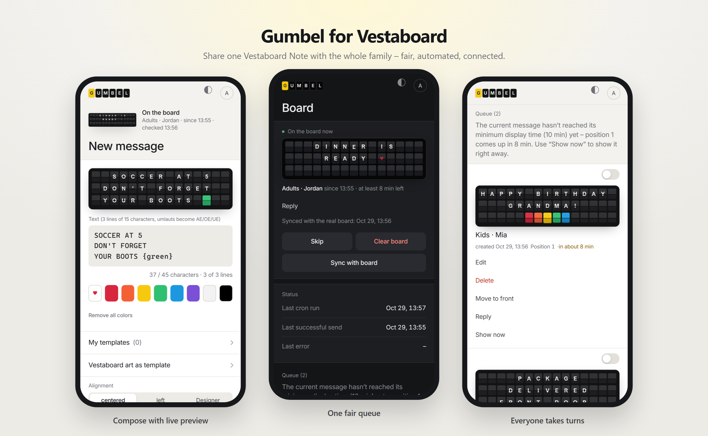
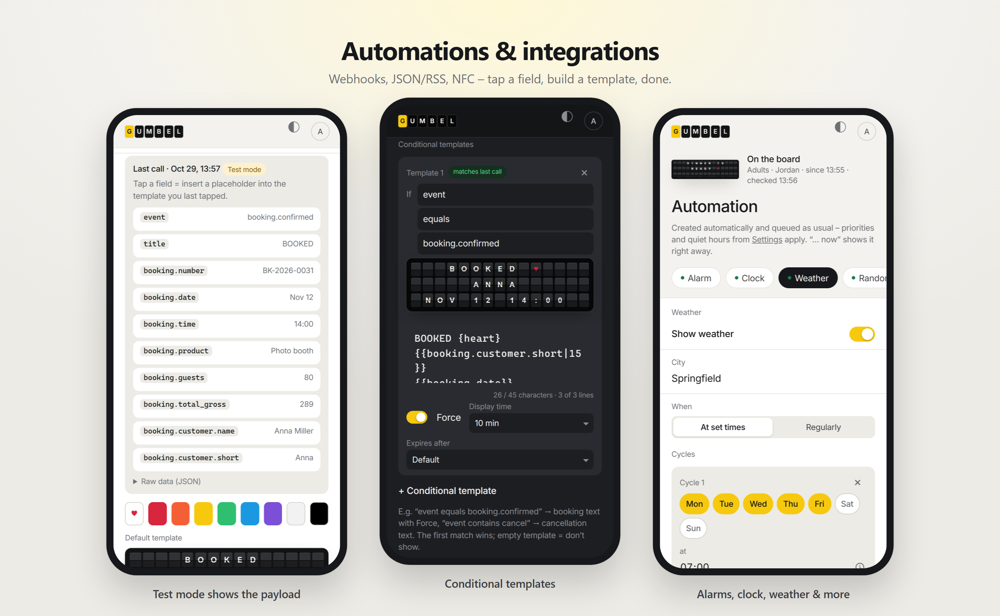

<p align="center">
  
</p>

<h3 align="center">Gumbel for Vestaboard</h3>
<p align="center">A self-hosted web app that lets your whole family (or team) share one <strong>Vestaboard Note</strong> – with a fair queue, automations and integrations.</p>

<p align="center">
  <a href="#quick-start-docker">Quick start</a> ·
  <a href="docs/en/HANDBOOK.md">Handbook</a> ·
  <a href="docs/en/INTEGRATIONS.md">Integrations</a> ·
  <a href="#license">License</a>
</p>

<p align="center">
  
</p>

> **Unofficial.** Gumbel is a community project and not affiliated with or endorsed by Vestaboard, Inc. “Vestaboard” is a trademark of Vestaboard, Inc.

## Why Gumbel?

The Vestaboard app is great for one person. In a household, everybody wants the board at the same time – and the last message simply wins.
Gumbel puts **one fair queue** in front of your board: every message waits its turn, stays up for a minimum time, and nobody overwrites anybody.

## Features

| | |
|---|---|
| ✍️ **Compose** | Live preview of the 3×15 board, colour tiles and ♥, *Designer* mode to paint tiles, Vestaboard art, saved templates, schedule for later. |
| 🧭 **Fair queue** | Priority by source, minimum display time, *jump the queue*, **Force** for the important stuff, quiet hours and one-click **quick mute** (optionally completely silent). |
| 💬 **Messenger** | Send to the board from **Telegram** (bot, approve chats with one click – works without a public address) or **Slack** (`/board Hello`). |
| 📮 **Guest mailbox** | Friends send a message **without an account** via a secret link or printable QR code – with per-device pause, hourly limit and expiry. |
| 👨‍👩‍👧 **Family-friendly** | Admin, adults and kids (PIN login, optional cooldown). Privacy: others only see “Other message”. Reply to a message, with read receipts. |
| ⏰ **Automation** | Alarms, clock (digital, in words, date), weather (Open-Meteo, no account), news headlines (RSS), random sayings & art – all with flexible schedules (“Mon–Fri 06:45, Sat + Sun 09:00”). |
| 🔌 **Integrations** | Webhooks from any service (Make, Zapier, IFTTT, n8n, Home Assistant …), JSON/RSS fetching with custom headers for API keys, NFC stickers via iPhone Shortcuts – plus **ready-made recipes** (news, Bitcoin, air quality, GitHub, football, Uptime Kuma, Shopify …) added with one click. |
| 📡 **Cloud or Local API** | Cloud API by default; switch to the Vestaboard **Local API** when Gumbel runs on your home network. |
| 🧩 **Templates & rules** | Test mode shows the incoming payload – tap fields to build templates like `{{booking.customer.name}}`, with filters, conditions, per-template Force/duration, time windows, de-duplication, delivery log, shareable recipes, optional HMAC signatures. |
| 📱 **Looks like an app** | Clean mobile-first design, light & dark, works great from the phone’s home screen. |
| 🌍 **English & German** | Interface, board texts (clock, weather, sayings) and docs. |

<p align="center">
  
</p>

## Quick start (Docker)

> 🧭 **New to Docker or servers?** Follow the **[step-by-step installation guide](docs/en/INSTALL.md)** – Docker Desktop, Synology, Raspberry Pi or web hosting, with troubleshooting.

Requirements: Docker and a Vestaboard (Read/Write API token from the Vestaboard app → *Settings → API*, or the Local API).

```bash
mkdir gumbel && cd gumbel
curl -fsSLO https://raw.githubusercontent.com/dhotzy/gumbel-for-vestaboard/main/docker-compose.yml
docker compose up -d
docker compose logs gumbel   # shows your one-time setup link
```

Open the setup link: **step 1** creates the admin account, **step 2** connects your board (Cloud API token or Local API) – done. Gumbel runs on port **8080**, keeps its data (SQLite) in the `gumbel-data` volume and runs its own minute cron inside the container. The image is built for `amd64` and `arm64` (Raspberry Pi).
Update with `docker compose pull && docker compose up -d`.

Want to try it without a board first? Set `GUMBEL_BOARD: "log"`.

**Going online?** Put Gumbel behind a reverse proxy with HTTPS (Caddy, Traefik, nginx) – don’t expose port 8080 to the internet. Then set `GUMBEL_TRUSTED_PROXIES` (the proxy’s IP, so login protection sees real client IPs) and `GUMBEL_FORCE_HTTPS: "1"` (secure cookies + HSTS).

<details>
<summary><strong>Classic PHP hosting (without Docker)</strong></summary>

Requirements: PHP 8.2+ (8.4 recommended) with `pdo_sqlite` or `pdo_mysql`, `curl`, `mbstring`, `intl`; HTTPS; a cron job every minute.

1. Upload the project and point your (sub)domain’s document root to **`public/`** – never to the project folder.
2. Copy `config/config.example.php` to `config/config.php` and fill in token, a long random `cron_key`, the database and `'language' => 'en'`.
3. Open `https://your-domain/setup.php?key=<cron_key>` and create the admin.
4. Add a cron job every minute – preferably on the command line: `php /path/to/gumbel/public/cron.php` (no key needed). If your host only offers URL cron jobs: `https://your-domain/cron.php?key=<cron_key>` (or send the key as `X-Cron-Key` header so it stays out of access logs).

> ⚠️ **Document root must be `public/`.** The other folders (`config/`, `var/` with the SQLite database and sessions, `src/` …) are protected only by `.htaccess`, which **nginx ignores** (and Apache with `AllowOverride None`). With nginx use e.g.:
> ```nginx
> server {
>     root /var/www/gumbel/public;
>     index index.php;
>     location ~ \.php$ { include fastcgi_params; fastcgi_param SCRIPT_FILENAME $document_root$fastcgi_script_name; fastcgi_pass unix:/run/php/php8.4-fpm.sock; }
>     location ~ /\. { deny all; }
> }
> ```

`scripts/deploy.php` can upload everything via FTPS (credentials in `config/deploy.ini`, not in Git).

</details>

## Documentation

- **[Installation guide](docs/en/INSTALL.md)** – step by step for Docker Desktop, Synology, Raspberry Pi and web hosting.
- **[Handbook](docs/en/HANDBOOK.md)** – every feature, for admins and family members.
- **[Integrations](docs/en/INTEGRATIONS.md)** – webhooks, fetching, NFC, templates, API reference, HMAC, examples (Home Assistant, Make, Zapier, IFTTT).
- All three are built into the app as well: *user menu → Help & handbook*.
- Deutsch: [Installation](docs/INSTALLATION.md) · [Handbuch](docs/HANDBUCH.md) · [Integrationen](docs/INTEGRATIONEN.md)

## Security

- Each integration has its own API key (stored only as a hash), optional HMAC signatures, size limits and rate limits; fetching blocks private networks, unusual ports and redirect tricks.
- Login protection per IP and per account+IP with growing lock times; admins must use a password (no PIN).
- Content Security Policy without inline scripts, CSRF tokens on every form, prepared SQL statements, output encoding everywhere.
- Self-hosted means you are the data controller: messages, names and delivery logs stay in your database. No tracking, no third-party requests except the Vestaboard API, Open-Meteo (weather/geocoding), the news feed you choose, Telegram (if connected) and fetch URLs you configure.
- Found a vulnerability? Please report it privately via GitHub’s *Security → Report a vulnerability* instead of a public issue.

## How it works

```
Compose / Automation / Integrations ──▶ Queue ──▶ Arbiter ──▶ Vestaboard
                     priority · minimum display time · Force · mute · quiet hours
```

Plain PHP 8 (no framework), SQLite or MySQL/MariaDB, one cron job. The arbiter is the only part that talks to the board; it runs every minute and right after every new message.

## Development

```bash
for t in tests/*-test.php; do php "$t" | tail -1; done             # all tests
VESTA_CONFIG=var/dev-config.php php -S 127.0.0.1:8766 -t public    # local server, use 'board_driver' => 'log'
```

- German is the source text in `t('…')`; English lives in `lang/en/*.php`. `tests/i18n-test.php` reports anything missing.
- Every feature change updates the docs (`docs/` and `docs/en/`) in the same commit.
- New integration modules: see [Integrations → For developers](docs/en/INTEGRATIONS.md).

## Roadmap

- 🎵 **Spotify “now playing”** – planned.
- 💬 **Signal / WhatsApp** – as soon as there is a usable official bot interface.
- Ideas, bug reports and recipes welcome – open an [issue](https://github.com/dhotzy/gumbel-for-vestaboard/issues) or a pull request (please run the tests first, see *Development*).

## License

[GNU AGPL v3](LICENSE) – free to use, change and share. If you run a modified version as a service for others, you must publish your changes under the same license.
