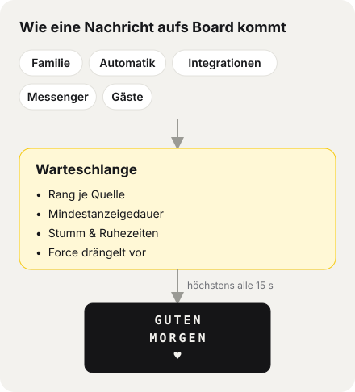

# Gumbel – Handbuch

Gumbel ist eine Web-App, mit der eine Familie (oder ein Team) gemeinsam ein **Vestaboard Note** (3 Zeilen × 15 Zeichen) bespielt.
Alle Nachrichten laufen durch **eine Warteschlange** mit klaren Regeln – niemand überschreibt einfach die Nachricht eines anderen.

> Stand: wird bei jeder Änderung an der App mitgepflegt. Technische Details zu Webhooks, Vorlagen und API: [Integrationen-Dokumentation](INTEGRATIONEN.md). Installation: [Schritt für Schritt](INSTALLATION.md).

## Inhalt
1. [Rollen und Anmeldung](#1-rollen-und-anmeldung)
2. [Schreiben](#2-schreiben)
3. [Board / Warteschlange](#3-board--warteschlange)
4. [Archiv](#4-archiv)
5. [Antworten](#5-antworten)
6. [Automatik](#6-automatik)
7. [Integrationen](#7-integrationen)
8. [Einstellungen](#8-einstellungen)
9. [Wie die Warteschlange entscheidet](#9-wie-die-warteschlange-entscheidet)
10. [Betrieb](#10-betrieb)

---

## 1. Rollen und Anmeldung

| Rolle | Anmeldung | Darf |
|---|---|---|
| **Admin** | Name + Passwort | alles: Board steuern, Automatik, Integrationen, Einstellungen, Nutzer, auf Nachrichten antworten |
| **Erwachsene** | Name + Passwort oder PIN | schreiben; je nach Rechten Force, vorne anstellen, planen |
| **Kinder** | Name + PIN | schreiben; optional mit **Pause** zwischen zwei Nachrichten (z. B. 15 Min) |

- Rechte pro Person (unter *Einstellungen → Nutzer*): **Force**, **vorne anstellen**, **planen**, jeweils mit Voreinstellung; dazu die Pause in Minuten.
- Nach mehreren falschen Versuchen (Passwort oder PIN) wird die Anmeldung von diesem Gerät gesperrt – erst kurz, bei Wiederholung immer länger (bis 24 Std.). Andere Personen und Geräte können sich weiter anmelden.
- Admins melden sich immer mit Passwort an (keine PIN).
- Man bleibt 30 Tage angemeldet.
- **Privatsphäre:** Nicht-Admins sehen fremde Nachrichten nur als „Andere Nachricht“ – weder Inhalt noch Absender. Im Archiv sehen sie nur ihre eigenen.
- Oben rechts, auf einer Linie: die **Glocke** (nur Admins, [Schnell-Mute](#8-einstellungen)), die **Darstellung** – Bildschirm = wie das System (Auto), Sonne = hell, Mond = dunkel; antippen schaltet weiter – und das Konto-Menü mit **Hilfe & Handbuch** (dieses Handbuch in der App; Admins sehen dort auch die Integrations-Dokumentation).
- Admins sehen oben auf jeder Seite (außer *Board* und *Hilfe*) mittig den **aktuellen Board-Stand**, darunter klein „Aktuell: Quelle · seit 14:30 Uhr“. Antippen öffnet die Board-Seite.

## 2. Schreiben

- **Text**: 3 Zeilen à 15 Zeichen. Umlaute werden zu AE/OE/UE (das Board kennt sie nicht). Die **Vorschau** zeigt live, wie es aussieht; der Zähler warnt, wenn es nicht passt.
- **Symbole**: Herz ♥ und die Farbkacheln (Rot, Orange, Gelb, Grün, Blau, Lila, Weiß, Schwarz) per Knopf. Im Text stehen sie als `{heart}`, `{red}` …
- **Alle Farben entfernen** löscht alle Farbkacheln aus dem Text.
- **Ausrichtung**: *mittig*, *links* oder **Designer** – im Designer steht jede Zeile genau so auf dem Board, und man malt mit Farbe/Herz/Radierer direkt auf die Kacheln der Vorschau.
- **Vestaboard-Kunst**: fertige Motive (Regenbogen, Herz, Wellen …) mit einem Tipp übernehmen.
- **Vorlagen**: eigenen Text „Als Vorlage speichern“ und später wieder laden (auch beim Wecker nutzbar). Admins sehen alle Vorlagen.
- **Wann?** *sofort / nächster freier Platz*, *in X Minuten* oder *am Datum/Uhrzeit* (nur mit Recht „planen“, höchstens 30 Tage im Voraus).
- **Vorlagen** höchstens 100 pro Person.
- **Optionen** (je nach Rechten): **Force** – kommt auch durch Stummschaltung/Ruhezeiten und unterbricht die laufende Nachricht; **vorne anstellen** – überholt gleichrangige Nachrichten.
- **Kinder-Pause**: Läuft die Pause noch, kann man schon schreiben; Abschicken geht, sobald der Countdown abgelaufen ist.

## 3. Board / Warteschlange

**Admin** („Board“):
- **Gerade auf dem Board** mit Quelle, Absender, Laufzeit und Restzeit der Mindestanzeigedauer; Live-Punkt.
- Knöpfe: **Überspringen**, **Board leeren**, **Mit Board abgleichen** (liest den echten Board-Inhalt). Wurde das Board außerhalb von Gumbel geändert (z. B. in der Vestaboard-App), erkennt der Abgleich das und archiviert es als Quelle **Extern**. Ist das Board in der Vestaboard-App stummgeschaltet, erscheint eine Warnung.
- Auf die laufende Nachricht direkt **antworten** (siehe 5), inkl. Lesestatus.
- **Status**: letzter Cron-Lauf, letzter erfolgreicher Versand, letzter Fehler; Warnung, wenn der Cron nicht läuft.
- **Warteschlange** mit Platz und geschätzter Zeit; je Nachricht *Bearbeiten*, *Löschen*, *Vorne anstellen*, *Antworten*, **Jetzt einspielen** (sofort, auch bei Stummschaltung). Mehrfachauswahl für Sammelaktionen.
- **Geplant** (mit Zeitpunkt), **Kommende Wecker**, fehlgeschlagene Nachrichten mit *Erneut versuchen*.

**Alle anderen** („Warteschlange“): eigene Nachrichten konkret, fremde als „Andere Nachricht“ mit Platz und ungefährer Wartezeit. Läuft die eigene gerade, steht „Deine Nachricht läuft gerade auf dem Board!“. Die Seite aktualisiert sich selbst, solange eine eigene Nachricht wartet.

## 4. Archiv

- Verlauf aller Nachrichten, nach Tagen gruppiert. Filter: **Zeitraum** (letzte Stunde, heute, letzte 10 Tage = Standard, letzte 30 Tage, alles) und **Status** für alle; **Quelle** und **Person** nur für Admins.
- Aktionen: **Erneut senden**, **Als Vorlage verwenden** (öffnet *Schreiben*), **Wiederherstellen** (gelöschte), **Löschen** (Admin, endgültig – mit Rückfrage), **Antworten** (Admin).
- Status: läuft, angezeigt, abgelaufen, gelöscht, fehlgeschlagen.

## 5. Antworten

- Der Admin kann auf die Nachricht einer Person antworten (Board, Warteschlange oder Archiv; höchstens 300 Zeichen). Die Antwort erscheint **nur in der App**, nicht auf dem Board.
- Die Person sieht oben einen Hinweis „… hat geantwortet“ und tippt auf **Gelesen**.
- Der Admin sieht unter der Antwort **„noch nicht gelesen“** bzw. **„✓ gelesen 29.10. 14:32“**.

## 6. Automatik

Admin-Menü *Automatik*, oben ein Pill-Menü **Wecker · Uhr · Wetter · Zufallspool · Nachrichten** (grüner Punkt = aktiv).
Automatik-Nachrichten stellen sich normal an; Rangfolge und Ruhezeiten gelten. „Jetzt …“-Knöpfe zeigen sofort.

**Zeitpläne aus Zyklen**: Überall, wo es um Zeiten geht, legt man einen oder mehrere **Zyklen** an – Wochentage + Uhrzeit (bzw. Zeitfenster). Beispiel: Zyklus 1 *Mo–Fr 06:30*, Zyklus 2 *Sa + So 08:30*. „+ Weiterer Zyklus“ fügt einen hinzu, × entfernt ihn.

- **Wecker**: Text (mit Vorschau, Symbolen, Designer, Vorlagen), Zyklen, *aktiv*, *Force* (auch bei Stummschaltung). Erscheint je Zyklus einmal am Tag zur Uhrzeit; kommende Wecker stehen auf der Board-Seite.
- **Takt je Zyklus**: Bei Uhr, Wetter (*Regelmäßig*) und Zufallspool hat jeder Zyklus seine Tage, sein Zeitfenster (von/bis) **und seinen eigenen Takt** – „alle [Std] [Min]“ über zwei Auswahlräder, mindestens 15 Minuten. Beispiel: Zyklus 1 *Mo–Fr 07–12 Uhr alle 2 Std*, Zyklus 2 *Mo–Fr 12–20 Uhr alle 45 Min*.
- **Uhr**: *Digital*, *In Worten* oder *Datum + Uhrzeit*; Zyklen mit Zeitfenster und Takt. Erscheint zur vollen Intervall-Zeit und verfällt nach 2 Minuten (sonst wäre die Uhrzeit falsch).
- **Wetter** (Open-Meteo, ohne Konto): Stadt; **Zu festen Zeiten** (Zyklen mit Uhrzeit, je Zyklus einmal am Tag) oder **Regelmäßig** (Zyklen mit Zeitfenster und Takt). Zeigt Stadt, Temperatur, Wetterlage, Tiefst-/Höchstwert. Schlägt der Abruf fehl, wird 30 Minuten lang alle 5 Minuten neu versucht.
- **Zufallspool**: ein Spruch pro Zeile mit eigenem **Schalter**, „+ Neuen Spruch anlegen“, × entfernen; **Herz und Farbkacheln** über die Leiste über der Liste (landen im zuletzt angetippten Spruch); Beispielsprüche per Knopf; dazu **Vestaboard-Kunst** zum Ein-/Ausschalten. **Änderungen werden automatisch gespeichert** (Hinweis „Gespeichert ✓“ neben dem Knopf); *Pool speichern* braucht man nur, falls die automatische Speicherung einmal meldet, dass es nicht geklappt hat. Nie zweimal derselbe hintereinander. Zu lange Sprüche werden rot markiert und bleiben ausgeschaltet.
- **Nachrichten**: Quelle *Tagesschau*, *BBC News* oder *eigene RSS-Adresse*; **1–3 Schlagzeilen**, jede als eigene Nachricht (oben die Quelle, darunter die Schlagzeile); Zyklen mit Uhrzeit, z. B. *Mo–Fr 07:00* und *Sa + So 09:00*, je Zyklus einmal am Tag. *Jetzt senden* zeigt sofort. Rang und Mindestdauer unter der Quelle **Nachrichten** in der Rangfolge.
- Lange automatische Texte (z. B. Ortsnamen) werden **gekürzt** statt abgeschnitten.

## 7. Integrationen

*Einstellungen → Integrationen*, Pill-Menü **Webhooks · Abrufen · NFC**. Kurz:

- **Webhooks**: Jeder Dienst, der Webhooks senden kann (direkt oder über Make, Zapier, IFTTT, n8n, Home Assistant), schickt Daten an die Webhook-URL mit API-Schlüssel.
- **Abrufen**: Gumbel holt regelmäßig eine JSON-Schnittstelle oder einen RSS-/Atom-Feed ab und zeigt Neues an.
- **NFC**: Ein Sticker löst per iPhone-Kurzbefehl eine feste Nachricht aus.
- **Testmodus** schneidet nur mit und zeigt die Felder des letzten Aufrufs zum Antippen; daraus baut man **Vorlagen** (`{{feld}}`, Filter wie `|10`, `|eur`, `|datum`), auch mehrere mit **Bedingung** (z. B. „event ist gleich booking.confirmed“).
- Je Vorlage **Force**, **Anzeigedauer** und **Ablauf**; je Integration **Zeitfenster**, **Duplikat-Schutz**, **Mindestabstand**, optional **HMAC-Signatur**.
- **Verlauf** der letzten 50 Aufrufe, **Rezepte** exportieren/importieren, **Jetzt testen**, **Neuer API-Schlüssel**.

Alles im Detail: [Integrationen-Dokumentation](INTEGRATIONEN.md).

## 8. Einstellungen

- **Sprache / Language**: Deutsch oder Englisch – gilt für Oberfläche und Board-Texte (Uhr in Worten, Wetter, Beispielsprüche).
- **Nutzer** (eigene Seite): je Person Name, **Rolle** (Admin, Erwachsene/r, Kind), Anmeldung mit **Passwort oder PIN** (Admins immer Passwort; Passwort mind. 8 Zeichen, PIN 4–8 Ziffern), **Quelle** (bestimmt den Rang), Rechte *Force*, *vorne anstellen*, *planen* mit Voreinstellung, *Pause* in Minuten. Nach zu vielen Fehlversuchen zeigt die Liste **gesperrt** – ein neues Passwort bzw. eine neue PIN hebt die Sperre auf. **Deaktivieren** statt Löschen: wartende Nachrichten der Person werden dabei gelöscht (im Archiv wiederherstellbar). Mindestens ein aktiver Admin bleibt immer.
- **Integrationen** (eigene Seite).
- **Messenger** (eigene Seite): Nachrichten per **Telegram** oder **Slack** aufs Board, als Quelle **Messenger**.
  - *Telegram*: bei @BotFather mit /newbot einen Bot anlegen, Token eintragen, *Verbinden*. Gumbel fragt jede Minute nach neuen Nachrichten (klappt auch zu Hause ohne öffentliche Adresse). Wer dem Bot schreibt, erscheint als **Anfrage** und wird einmal **freigegeben** (oder *abgelehnt*; *Jetzt abfragen* holt neue Nachrichten sofort); nur Einzel-Chats, keine Gruppen. Der Bot bestätigt jede Nachricht (z. B. „✓ Ist in der Warteschlange (Platz 2)“). *Entfernen* nimmt die Freigabe zurück, *Trennen* löscht Token und Freigaben.
  - *Slack*: App auf api.slack.com/apps anlegen, Slash-Befehl (z. B. `/board`) mit der angezeigten Request URL, Signing Secret eintragen, *Slack aktiv*. Braucht eine öffentlich erreichbare Installation mit HTTPS; jede Anfrage wird per Signatur geprüft.
  - Für beide: *Pause pro Person* und *verfällt nach*. Zu lange Texte werden gekürzt. Signal und WhatsApp haben keine offizielle Bot-Schnittstelle.
- **Briefkasten** (eigene Seite): Freunde und Gäste schicken **ohne Konto** eine Nachricht – über einen geheimen Link oder QR-Code (Download als SVG, Druckansicht zum Aufhängen). Gäste können nur Text, Farben und Herzen schreiben und optional ihren Namen angeben (sieht nur der Admin). Einstellbar: *vorne anstellen*, *Gäste dürfen Force*, *Pause pro Gerät*, *höchstens pro Stunde*, *höchstens wartend*, *verfällt nach*. Rang und Mindestdauer stehen bei der Quelle **Gäste** in der Rangfolge. *Neuen Link erstellen* macht alte Links und gedruckte QR-Codes sofort ungültig; ausgeschaltet zeigt der Link nur „Briefkasten geschlossen“. Gast-Nachrichten lassen sich wie alle anderen löschen; Antworten gibt es für Gäste nicht.
- **Board-Verbindung** (eigene Seite): **Cloud API** (Standard, funktioniert überall) oder **Local API** (direkt im Heimnetz, ohne Vestaboard-Cloud, schneller – nur wenn Gumbel im selben Netz läuft, z. B. per Docker oder Raspberry Pi). Für die Local API auf vestaboard.com/local-api einen Freischalt-Token anfordern, dann Board-Adresse (IP) und Token eintragen – Gumbel holt sich einmalig den dauerhaften Key. *Verbindung testen* liest das Board einmal. Ein Token in `config.php` bzw. `VESTABOARD_TOKEN` hat Vorrang vor dem Feld in der Oberfläche.
- **Eigene Quellen**: zusätzliche Quellen anlegen (z. B. „Buchungen“, „Home Assistant“), um Integrationen einen eigenen Rang und eine eigene Mindestanzeigedauer zu geben. Löschen geht, sobald keine Integration sie mehr nutzt.
- **Rangfolge & Mindestanzeigedauer**: Quellen per Ziehen (oder Pfeilen) sortieren – oben = wichtiger. Je Quelle die Mindestzeit, die eine Nachricht stehen bleibt, bevor die nächste kommt.
- **Unterbrechen**: Diese Quellen dürfen die Mindestanzeigedauer *anderer* Quellen beenden (Standard: Wecker, Admin) – nicht gegenüber derselben Quelle und nicht gegenüber laufenden Force-Nachrichten.
- **Stummschaltung**: aus / an / an bis Zeitpunkt; dazu **einzelne Quellen immer stumm**. Force kommt durch – außer mit **komplett still**, dann warten auch Force-Nachrichten.
- **Schnell-Mute** (Admins, Glocke oben rechts auf jeder Seite): „Board stumm schalten für …“ *30 Min*, *1 Std*, *2 Std*, *4 Std*, eine **eigene Dauer** (0,5–48 Std, Zahl eintippen → *Std. stumm*) oder *bis ich es beende*, optional **komplett still**. Solange es stumm ist, sehen alle einen gelben Hinweis; die Glocke ist durchgestrichen. *Stummschaltung beenden* schaltet sofort zurück, danach wird die Warteschlange abgearbeitet (abgelaufene Nachrichten verfallen wie sonst auch).
- **Ruhezeiten**: wiederkehrende Zeitfenster (z. B. täglich 22:00–07:00), mehrere möglich.
- **Force**: alle Nachrichten oder bestimmte Quellen immer als Force.
- **Ruhezustand** (Standard nach 30 Minuten): was nach X Minuten ohne Neues passiert – *letzte Nachricht bleiben lassen*, *Board leeren* oder *festen Text anzeigen*.

## 9. Wie die Warteschlange entscheidet

Nur eine Stelle sendet ans Board (der „Arbiter“). Er läuft jede Minute und sofort nach jeder neuen Nachricht.

1. Abgelaufene Nachrichten fallen raus; geplante warten bis zu ihrem Zeitpunkt.
2. Bei Stummschaltung/Ruhezeit kommen nur **Force**-Nachrichten durch, die anderen warten.
3. **Force** wird sofort gezeigt (bei laufender Force-Nachricht entscheidet der Rang).
4. Sonst wartet die laufende Nachricht ihre **Mindestanzeigedauer** ab – außer eine Quelle mit „Unterbrechen“ kommt.
5. Danach gewinnt: **höherer Rang → vorne angestellt → älteste zuerst**.
6. Das Vestaboard nimmt höchstens alle 15 Sekunden etwas an; Fehler werden bis zu dreimal wiederholt.

Nachrichten aus Integrationen können eine **eigene Anzeigedauer** mitbringen (je Vorlage einstellbar).

**Standard-Rangfolge und Mindestanzeigedauer** (änderbar unter *Einstellungen*): Wecker 5 Min · Admin 10 · Erwachsene 10 · Kinder 5 · NFC 5 · Wetter 5 · Uhr 2 · Webhook 5 · Social Media 3 (Webhook-Quelle für Social-Media-Dienste) · Abruf 5 · Zufallspool 5 · Nachrichten 3 · Gäste 5 · Messenger 5 – plus eigene Quellen.

## 10. Betrieb

- **Installation** Schritt für Schritt (Docker Desktop, Synology, Raspberry Pi, Webhosting): [INSTALLATION.md](INSTALLATION.md). Ersteinrichtung in zwei Schritten: Admin anlegen, Board verbinden.
- Docker: SQLite im Volume `gumbel-data`, Cron läuft im Container. Webhosting: PHP 8.2+ mit aktuellen Sicherheitsupdates (mindestens 8.2.35 / 8.3.36 / 8.4.27 / 8.5.12; sonst sehen Admins auf der Board-Seite eine Sicherheitswarnung) mit MariaDB/MySQL oder SQLite, Cronjob **jede Minute** auf `cron.php` (Board-Abgleich, Automatik, Abrufe, Telegram, Arbiter).
- Am besten per Kommandozeile: `php public/cron.php` (kein Schlüssel nötig). Per URL nur mit Schlüssel – lieber als Header `X-Cron-Key` als `?key=` (landet sonst in Logs). Läuft ein Durchgang noch, wird der nächste übersprungen.
- Datenbank-Änderungen laufen automatisch beim ersten Seitenaufruf (Migrationen).
- **Sicherheit:** Document-Root muss `public/` sein (nginx ignoriert `.htaccess`). Hinter einem Reverse-Proxy dessen IP eintragen und bei TLS am Proxy HTTPS erzwingen: Docker `GUMBEL_TRUSTED_PROXIES` / `GUMBEL_FORCE_HTTPS`, Webhosting `trusted_proxies` / `force_https` in `config/config.php`. Strenge Content-Security-Policy, keine Inline-Skripte.
- Tests: siehe [README](../README.md).
