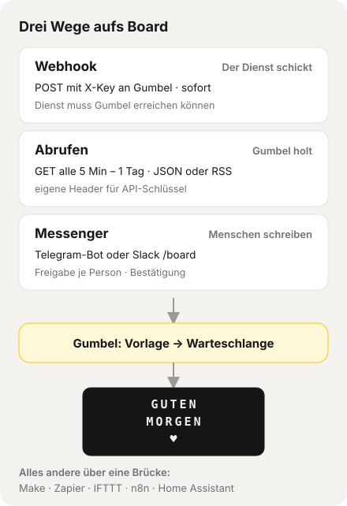
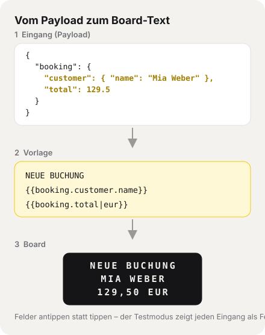

# Gumbel – Integrationen

Wie andere Dienste, Geräte und Menschen Texte auf das Vestaboard bringen: per **Webhook**, per **Abruf** (JSON/RSS), per **NFC-Sticker** oder per **Messenger** (Telegram, Slack).
Alles wird in der App unter *Einstellungen → Integrationen* bzw. *Einstellungen → Messenger* eingerichtet – auf der Gumbel-Seite ohne Programmieren.

> Wird bei jeder Änderung mitgepflegt. In der App unter *Nutzermenü → Hilfe & Handbuch → Integrationen*. Übersicht über die ganze App: [Handbuch](HANDBUCH.md).

## Inhalt
1. [Überblick](#1-überblick)
2. [Welcher Weg passt zu meinem Dienst?](#2-welcher-weg-passt-zu-meinem-dienst)
3. [Schnellstart: Webhook in 5 Minuten](#3-schnellstart-webhook-in-5-minuten)
4. [Deinen Dienst einbinden: Schritt für Schritt](#4-deinen-dienst-einbinden-schritt-für-schritt)
5. [Webhook-API](#5-webhook-api)
6. [Vorlagen, Platzhalter und Filter](#6-vorlagen-platzhalter-und-filter)
7. [Vorlagen mit Bedingung](#7-vorlagen-mit-bedingung)
8. [Optionen: Force, Anzeigedauer, Ablauf](#8-optionen-force-anzeigedauer-ablauf)
9. [Zeitfenster, Duplikate, Mindestabstand](#9-zeitfenster-duplikate-mindestabstand)
10. [Testmodus und Verlauf](#10-testmodus-und-verlauf)
11. [Sicherheit: API-Schlüssel und HMAC-Signatur](#11-sicherheit-api-schlüssel-und-hmac-signatur)
12. [Abrufen: JSON und RSS](#12-abrufen-json-und-rss)
13. [NFC-Sticker (iPhone)](#13-nfc-sticker-iphone)
14. [Messenger: Telegram und Slack](#14-messenger-telegram-und-slack)
15. [Rezepte: fertige Sammlung, Export und Import](#15-rezepte-fertige-sammlung-export-und-import)
16. [Beispiele](#16-beispiele)
17. [Grenzen und wie man sie umgeht](#17-grenzen-und-wie-man-sie-umgeht)
18. [Fehlersuche](#18-fehlersuche)
19. [Für Entwickler: neues Modul einbinden](#19-für-entwickler-neues-modul-einbinden)

---

## 1. Überblick



- **Webhook – der Dienst schickt.** Er ruft bei einem Ereignis (neue Buchung, Server down, Waschmaschine fertig) die Webhook-URL von Gumbel auf. Kommt sofort an. Voraussetzung: Der Dienst kann Gumbel erreichen (siehe [Grenzen](#17-grenzen-und-wie-man-sie-umgeht)).
- **Abrufen – Gumbel holt.** Gumbel fragt in einem festen Takt (5 Min – 1 Tag) eine Adresse ab: eine JSON-Schnittstelle oder einen RSS-/Atom-Feed. Klappt auch, wenn Gumbel zu Hause ohne öffentliche Adresse läuft.
- **Messenger – Menschen schreiben.** Freigegebene Personen schreiben dem eigenen Telegram-Bot oder nutzen in Slack `/board Text`.
- Außerdem: **NFC-Sticker** (ein Antippen mit dem iPhone löst einen festen Text aus) und der **Briefkasten** für Gäste ohne Konto (siehe [Handbuch](HANDBUCH.md)).

Was davon aufs Board kommt, bestimmt die **Vorlage** in Gumbel: Ein Dienst schickt beliebige Daten, du suchst dir die Felder aus. Danach stellt sich die Nachricht **in die Warteschlange** – nichts wird überschrieben, zu lange Texte werden **gekürzt** statt abgelehnt. Jede Integration hat eine **Quelle** (z. B. *Webhook*, *Abruf (Feed)*, *NFC*, *Messenger* oder eine **eigene Quelle**), und die Quelle bestimmt Rang und Mindestanzeigedauer in den Einstellungen.

## 2. Welcher Weg passt zu meinem Dienst?

Frag dich der Reihe nach:

| Frage | Ja → | Beispiele |
|---|---|---|
| Gibt es ein **fertiges Rezept**? | *Integrationen → Webhooks/Abrufen → Fertige Rezepte → Hinzufügen* | Tagesschau, BBC, Bitcoin, GitHub, Uptime Kuma, Shopify, Home Assistant |
| Kann der Dienst **Webhooks senden** (Einstellung „Webhook“, „Benachrichtigung per URL“, „HTTP-Request“ – per **POST**)? | **Webhook** ([Weg A](#weg-a-der-dienst-kann-webhooks-senden)) | Buchungssysteme, Shopify, GitHub, Uptime Kuma, Home Assistant, eigene Skripte |
| Hat der Dienst eine **API mit JSON** oder einen **RSS-Feed**, den man per Adresse abfragen kann? | **Abrufen** ([Weg B](#weg-b-der-dienst-hat-eine-api-oder-einen-feed)) | Nachrichten, Kurse, Wetterwerte, Projekt-Statistiken, Fußball |
| Gibt es den Dienst bei **Make, Zapier, IFTTT oder n8n**? | **Brücke** ([Weg C](#weg-c-brücke-über-make-zapier-ifttt-oder-n8n)) | Google Kalender, Gmail, Outlook, Trello, Notion, Spotify, Instagram |
| Sollen **Menschen** etwas schicken (ohne App-Konto)? | **Messenger** oder **Briefkasten** ([Weg D](#weg-d-menschen-schreiben-telegram-slack-briefkasten)) | Familie unterwegs, Kolleg:innen, Gäste |
| Ein **fester Text auf Knopfdruck**? | **NFC-Sticker** ([Abschnitt 13](#13-nfc-sticker-iphone)) | „ESSEN IST FERTIG“ an der Küchentür |

Faustregel: **Webhook vor Abrufen** (sofort statt im Takt, keine unnötigen Abfragen). **Abrufen**, wenn der Dienst nichts senden kann – oder Gumbel zu Hause nicht erreichbar ist.

## 3. Schnellstart: Webhook in 5 Minuten

1. *Integrationen → Webhooks → + Neuer Webhook*, Namen vergeben, Quelle wählen, anlegen.
2. **Webhook-URL** und **API-Schlüssel** kopieren (der Schlüssel wird nur jetzt angezeigt) und im Dienst eintragen: Methode `POST`, Header `X-Key: <Schlüssel>`.
3. Beim Webhook **Testmodus** einschalten, speichern, im Dienst einmal auslösen.
4. Unter „Letzter Aufruf“ erscheinen alle Felder – antippen fügt Platzhalter wie `{{booking.customer.name}}` in die Vorlage ein. Die Vorschau zeigt das echte Ergebnis.
5. Testmodus aus, speichern. Fertig.

Ausprobieren ohne Dienst – mit `curl` im Terminal:

```bash
curl -X POST "https://<deine-domain>/api/inbound.php" \
  -H "Content-Type: application/json" -H "X-Key: <Schlüssel>" \
  -d '{"text": "HALLO VOM TERMINAL"}'
```

## 4. Deinen Dienst einbinden: Schritt für Schritt

### Weg A: Der Dienst kann Webhooks senden

1. **In Gumbel:** *Integrationen → Webhooks → + Neuer Webhook*. Als Quelle *Webhook* oder eine eigene Quelle (z. B. „Buchungen“, angelegt unter *Einstellungen → Eigene Quellen*) – damit bekommt der Dienst eigenen Rang und eigene Mindestdauer.
2. **Im Dienst** den Webhook anlegen. Was du dort brauchst:
   - **URL:** die angezeigte Webhook-URL (`…/api/inbound.php`).
   - **Methode:** `POST`. **Format:** JSON (`application/json`) – Formular (`application/x-www-form-urlencoded`) geht auch.
   - **Schlüssel:** am besten als Header `X-Key`. Kann der Dienst keine eigenen Header setzen (z. B. GitHub, Shopify), hänge ihn an die URL: `…/api/inbound.php?key=<Schlüssel>` (landet dann im Server-Log, daher Header bevorzugen).
   - Programmierst du den Sender selbst (Skript, n8n/Make mit Code-Schritt), kannst du die [HMAC-Signatur](#11-sicherheit-api-schlüssel-und-hmac-signatur) nutzen. Die eigenen Signaturen von GitHub, Stripe oder Shopify erkennt Gumbel nicht – dort reicht der Schlüssel.
   - Wiederholt der Dienst Aufrufe bei Fehlern (viele tun das), eine Ereignis-ID als **Duplikat-Schlüssel** eintragen (z. B. `{{id}}`), damit nichts doppelt erscheint.
3. **Testmodus** einschalten und im Dienst einen Test auslösen (viele Dienste haben „Testnachricht senden“). Unter *Letzter Aufruf* siehst du jetzt alle Felder (der letzte Aufruf wird immer gespeichert; der Testmodus verhindert nur, dass etwas aufs Board geht).
4. **Vorlage bauen:** Felder antippen. Für unterschiedliche Ereignisse **Vorlagen mit Bedingung** anlegen (z. B. `event` *ist gleich* `order.paid` → `BEZAHLT {green}`). Unwichtiges mit leerer Vorlage ausblenden.
5. **Feinschliff:** Force für Wichtiges, Zeitfenster (z. B. nachts nicht), Duplikat-Schutz, Mindestabstand.
6. **Testmodus aus.** Ab jetzt landet jedes Ereignis in der Warteschlange; der Verlauf zeigt die letzten 50 Aufrufe.

### Weg B: Der Dienst hat eine API oder einen Feed

1. **Adresse finden:** In der API-Doku des Dienstes nach einer Adresse suchen, die per **GET** JSON liefert (oft „REST API“, „Endpoint“, „/v1/…“). Für Nachrichten- und Blog-Seiten reicht der **RSS-Feed** (Symbol 📶 oder „RSS“ auf der Seite).
2. **Schlüssel?** Viele APIs verlangen einen API-Schlüssel. So trägst du ihn ein:

   | Die API-Doku sagt … | In Gumbel |
   |---|---|
   | „Header `Authorization: Bearer <token>`“ | **Eigene Header:** `Authorization: Bearer DEIN-TOKEN` |
   | „Header `X-Api-Key` / `X-Auth-Token` …“ | **Eigene Header:** `X-Api-Key: DEIN-SCHLÜSSEL` |
   | „Parameter `?apikey=…` / `&appid=…`“ | direkt in die **Adresse** (beim Rezept-Export wird er zu `YOUR-KEY`) |
   | „Basic Auth“ (Benutzer + Passwort) | **Eigene Header:** `Authorization: Basic <base64 von benutzer:passwort>` (nicht `benutzer:pass@` in die Adresse) |
   | „OAuth“, „Login mit Google/Microsoft“ | geht nicht direkt → [Weg C](#weg-c-brücke-über-make-zapier-ifttt-oder-n8n). Viele Dienste bieten aber zusätzlich ein **persönliches Token** (GitHub Personal Access Token, Notion Internal Integration, Home Assistant Long-Lived Token) – das geht als `Authorization: Bearer …`. |

   **Vorher testen:** die Adresse im Browser öffnen (Firefox zeigt JSON übersichtlich als Baum) oder mit `curl -H "X-Api-Key: …" "https://…"`. Den Pfad zum gewünschten Wert ablesen – Ebenen mit Punkt, Listen mit Index (`data.0.temperature`). Achtung: Manche APIs antworten bei Fehlern mit HTTP 200 und einer Fehlermeldung als JSON – die landet dann als Payload im Mitschnitt.
3. **In Gumbel:** *Integrationen → Abrufen → + Neuer Abruf*, Adresse, Takt (5 Min – 1 Tag) und ggf. eigene Header eintragen, anlegen. Die Adresse ist fest – Variablen wie das heutige Datum gehen nicht.
4. **Jetzt abrufen** – die Antwort erscheint als Feldliste. Fehler (falscher Schlüssel → HTTP 401/403, falsche Adresse → 404) stehen im Verlauf.
5. **Vorlage bauen** wie bei Webhooks, z. B. `{{data.temperature|zahl}} GRAD`. Listen mit Index: `{{items.0.title}}`, `{{results.0.name}}`.
6. **Testmodus aus.** Gumbel holt jetzt im Takt – und zeigt nur, wenn sich der Text **geändert** hat.

Tipp: Lieber selten abrufen (z. B. 1 Std) – viele kostenlose APIs haben ein Tageslimit. Für Schlagzeilen zu **festen Uhrzeiten** (z. B. morgens um 7) ist *Automatik → Nachrichten* besser geeignet als ein Abruf.

### Weg C: Brücke über Make, Zapier, IFTTT oder n8n

Für Dienste mit Login (Google, Microsoft, Spotify, Instagram …) oder ohne eigene Webhooks: Die Brücke übernimmt die Anmeldung und schickt Gumbel einen Webhook.

1. In Gumbel einen **Webhook** anlegen (Weg A, Schritte 1–3).
2. In der Brücke ein Szenario: **Auslöser** des Dienstes (z. B. „Neuer Termin in Google Kalender“, „Neue E-Mail mit Label …“) → Aktion **HTTP-Request / Webhook**:
   - Make: Modul *HTTP → Make a request*; Zapier: *Webhooks by Zapier → POST*; IFTTT: *Webhooks → Make a web request*; n8n: Node *HTTP Request*.
   - URL = Webhook-URL, Methode POST, Header `X-Key`, Body JSON, z. B. `{"text": "{{Titel}}", "start": "{{Beginn}}"}`.
   - Hinweis: Bei Zapier (*Webhooks*) und IFTTT (*Additional Headers*) braucht man dafür einen Bezahlplan; dann den Schlüssel notfalls per `?key=` an die URL hängen. Make und n8n gehen kostenlos.
3. In Gumbel die Vorlage bauen, z. B. `TERMIN` / `{{text|15}}` / `{{start|zeit}} UHR` (ganztägige Termine ergeben bei `|zeit` „00:00“ – dafür eine Bedingung anlegen).

### Weg D: Menschen schreiben (Telegram, Slack, Briefkasten)

- **Telegram:** eigener Bot, Freigabe je Person – [Abschnitt 14](#14-messenger-telegram-und-slack). Klappt auch ohne öffentliche Adresse.
- **Slack:** Slash-Befehl `/board Text` – [Abschnitt 14](#14-messenger-telegram-und-slack). Braucht eine öffentlich erreichbare Installation.
- **Briefkasten:** geheimer Link oder QR-Code, Gäste schreiben ohne Konto – siehe [Handbuch](HANDBUCH.md).

## 5. Webhook-API

**Endpunkt:** `POST https://<deine-domain>/api/inbound.php`

**Header**

| Header | Pflicht | Inhalt |
|---|---|---|
| `X-Key` | ja | API-Schlüssel der Integration. Reihenfolge: Header `X-Key`, sonst `?key=` in der URL (nur für Dienste ohne eigene Header wie GitHub oder Shopify; landet im Server-Log), sonst Feld `key` im Body |
| `Content-Type` | empfohlen | `application/json` oder `application/x-www-form-urlencoded` (ohne Angabe = Formular) |
| `X-Timestamp`, `X-Signature` | nur mit HMAC | siehe [Abschnitt 11](#11-sicherheit-api-schlüssel-und-hmac-signatur) |

**Body** – beliebig. Diese Felder haben eine feste Bedeutung:

| Feld | Bedeutung |
|---|---|
| `text` | wird angezeigt, wenn die Standard-Vorlage leer ist |
| `force` | `true` = Force, nur wenn „Force per Payload erlaubt“ an ist |
| `expires_in_min` | Ablauf in Minuten (1–1440), wenn die Vorlage „Standard“ hat |

Maximal 64 KB; nur JSON oder Formular-Daten, nur `POST`.

**Antworten**

| HTTP | Body | Bedeutung |
|---|---|---|
| 200 | `{"ok": true, "message_id": 123}` | eingereiht |
| 200 | `{"ok": true, "message_id": 123, "held_until": "2026-10-30 07:00:00"}` | außerhalb des Zeitfensters, erscheint später (UTC) |
| 200 | `{"ok": true, "ignored": true}` | nicht angezeigt (keine Vorlage passt, „nicht anzeigen“ oder Duplikat) |
| 200 | `{"ok": true, "test": true, "text": "…"}` | Testmodus: nur mitgeschnitten; `text` = was angezeigt würde |
| 400 | `{"ok": false, "error": "Ungültiges JSON."}` | Body kaputt |
| 401 | `{"ok": false, "error": "…"}` | Schlüssel fehlt/falsch, Integration aus, Signatur ungültig |
| 405 | `{"ok": false, "error": "Nur POST erlaubt."}` | nicht POST (z. B. ein Gerät, das die URL per GET aufruft) |
| 413 | `{"ok": false, "error": "…"}` | Body größer als 64 KB |
| 415 | `{"ok": false, "error": "…"}` | anderer Content-Type als JSON/Formular |
| 429 | `{"ok": false, "error": "…"}` | Mindestabstand nicht erreicht oder 20 Nachrichten dieser Quelle warten schon |
| 500 | `{"ok": false, "error": "Interner Fehler"}` | Fehler in Gumbel (steht im Server-Log) |

Empfehlung für Sender: Timeout ~3 s, im Hintergrund senden, bei 429 höchstens einmal später wiederholen.

## 6. Vorlagen, Platzhalter und Filter



- `{{feld.pfad}}` setzt einen Wert aus dem Payload ein – verschachtelt mit Punkt, Listen mit Index: `{{items.0.title}}`. Ist die ganze Antwort eine Liste, beginnt der Pfad mit dem Index: `{{0.name}}`.
- Fehlende Felder werden leer. `true/false` wird `JA/NEIN` (auf Englisch `YES/NO`). Großbuchstaben macht erst das Board.
- Die Feldliste zeigt bis zu 60 Felder; sehr große Antworten werden im Mitschnitt gekürzt (lange Texte und Listen), die Felder bleiben aber antippbar.
- Farbkacheln und Herz wie überall: `{heart}`, `{red}` …
- **Leere Standard-Vorlage** = Feld `text` aus dem Payload.

**Filter** (hinter `|`, kombinierbar, von links nach rechts; die englischen Namen `number`, `date`, `time`, `or:` gehen genauso):

| Filter | Beispiel | Ergebnis |
|---|---|---|
| Zahl = auf so viele Zeichen kürzen (an Wortgrenzen) | `{{name\|8}}` | `Anna Müller` → `ANNA` |
| `zahl` | `{{total\|zahl}}` | `1234.5` → `1.234,50` |
| `eur` | `{{total_gross\|eur}}` | `289` → `289 EUR` |
| `datum` | `{{start\|datum}}` | `2026-11-12T13:00:00Z` → `12.11.` (ISO-Datum oder Unix-Sekunden) |
| `zeit` | `{{start\|zeit}}` | → `14:00` (Ortszeit = eingestellte Zeitzone) |
| `oder:TEXT` | `{{booking.time\|oder:GANZTAGS}}` | Ersatz, wenn leer |

Beispiel: `{{title}}` / `{{booking.customer.short|15}}` / `{{booking.date}} {{booking.time|oder:}}`

**Zeitzone:** Ortszeit, Zeitfenster und Zyklen richten sich nach der eingestellten Zeitzone – Docker: Variable `TZ` in der `docker-compose.yml`, Webhosting: `timezone` in `config/config.php` (Standard `Europe/Berlin`).

**Kürzen:** Passt das Ergebnis nicht auf 3 × 15, kürzt Gumbel automatisch: Zeilenumbrüche (Absätze) bleiben, jeder Absatz bekommt mindestens eine Zeile, freie Zeilen gehen an den Absatz, der sie braucht; gekürzt wird an Wortgrenzen (Umlaute zählen doppelt: Ü = UE).

## 7. Vorlagen mit Bedingung

Neben der Standard-Vorlage beliebig viele (bis 10) **Vorlagen mit Bedingung**:

> **Wenn** `event` *ist gleich* `booking.confirmed` → `GEBUCHT {heart}` / `{{booking.customer.short}}`

- Vergleiche: **ist gleich**, **enthält**, **ist vorhanden** (Groß-/Kleinschreibung egal; `true`/`false` als Text vergleichen).
- Die **erste passende** gewinnt (Reihenfolge = von oben nach unten). Passt keine → Standard-Vorlage.
- **Leere Vorlage = nicht anzeigen** (z. B. für Ping- oder Test-Ereignisse).
- Jede Vorlage hat eine eigene Vorschau mit dem letzten Aufruf; „passt auf letzten Aufruf“ zeigt, welche greifen würde.

## 8. Optionen: Force, Anzeigedauer, Ablauf

Je Vorlage (Standard und jede mit Bedingung):

| Option | Wirkung |
|---|---|
| **Force** | kommt durch Stummschaltung/Ruhezeiten, unterbricht laufende Nachrichten (außer bei „komplett still“) |
| **Anzeigedauer** | Mindestanzeigedauer dieser Nachricht (1–30 Min) statt der der Quelle |
| **Verfällt nach** | wie lange sie warten darf (15 Min – 24 Std); „Standard“ = 60 Min bzw. `expires_in_min` |

Beispiel Buchungssystem: Buchung mit Force und 10 Min Anzeige, Anfrage normal, Storno 2 Min.

## 9. Zeitfenster, Duplikate, Mindestabstand

- **Zeitfenster** (je Integration, Zyklen aus Tagen + von/bis): außerhalb wird die Nachricht **zurückgehalten** und erscheint, sobald das nächste Fenster beginnt; der Ablauf zählt ab dann. Ohne Zeitfenster: immer.
- **Duplikate**: Duplikat-Schlüssel als Vorlage, z. B. `{{event}}-{{booking.number}}`, plus Zeitraum (10 Min – 7 Tage). Gleicher Schlüssel im Zeitraum → ignoriert (Status „Duplikat“).
- **Mindestabstand**: kein / 10 Sek / 1 / 5 / 15 Min zwischen zwei Nachrichten dieser Integration. Webhooks standardmäßig *kein*, NFC *1 Min* (Doppel-Antippen).
- **Flut-Schutz**: höchstens 20 wartende Nachrichten je Quelle, darüber 429.

## 10. Testmodus und Verlauf

- **Testmodus**: Aufrufe werden gespeichert und ausgewertet, aber nichts geht aufs Board; Mindestabstand, Zeitfenster und Duplikat-Prüfung entfallen. Die Antwort enthält `"test": true` und den Text. Importierte Rezepte starten im Testmodus.
- **Letzter Aufruf**: alle Felder zum Antippen + Rohdaten (JSON).
- **Jetzt testen**: füllt die passende Vorlage mit dem letzten Aufruf und stellt sie sofort an.
- **Verlauf**: die letzten 50 Aufrufe je Integration mit Status, Text, verwendeter Vorlage, Hinweis und Payload.

| Status | Bedeutung |
|---|---|
| eingereiht | in der Warteschlange |
| zurückgehalten | außerhalb des Zeitfensters, erscheint später |
| Testmodus | nur mitgeschnitten |
| ignoriert | keine passende Vorlage / „nicht anzeigen“ |
| Duplikat | gleicher Duplikat-Schlüssel im Zeitraum |
| Fehler | Signatur, Mindestabstand, Warteschlange voll, Abruf fehlgeschlagen |

Ein Abruf ohne Neues wird nicht protokolliert (bei *Jetzt abrufen* steht „nichts Neues“).

## 11. Sicherheit: API-Schlüssel und HMAC-Signatur

- **API-Schlüssel**: pro Integration, 48 Zeichen, gespeichert nur als SHA-256-Hash. Er wird beim Anlegen einmal angezeigt; verloren → **Neuer API-Schlüssel** (der alte ist sofort ungültig). Immer per HTTPS senden. Der Schlüssel wird nie im Verlauf gespeichert.
- **HMAC-Signatur** (optional, für selbst gebaute Sender – die Signaturverfahren von GitHub, Stripe oder Shopify werden nicht erkannt): schützt vor gefälschten und wiederholten Aufrufen.
  1. *Sicherheit & Tempo → Signatur-Geheimnis erzeugen* (beginnt mit `whsec_`, nur einmal sichtbar).
  2. Im Sender: `X-Timestamp` = Unix-Zeit in Sekunden, `X-Signature` = `sha256=` + HMAC-SHA256 über `"<timestamp>.<roher Body>"` mit dem Geheimnis (hex).
  3. „HMAC-Signatur verlangen“ einschalten. Zeitstempel älter als 5 Minuten werden abgelehnt.
- **Eigene Header beim Abrufen** (API-Schlüssel anderer Dienste) werden nie wieder angezeigt, nie exportiert und nur an die eingetragene Adresse geschickt – nicht an Weiterleitungen auf einen anderen Host oder von HTTPS nach HTTP.

```js
// Node.js
import crypto from 'node:crypto';
const body = JSON.stringify(payload);
const ts = Math.floor(Date.now() / 1000).toString();
const sig = 'sha256=' + crypto.createHmac('sha256', process.env.GUMBEL_SECRET).update(`${ts}.${body}`).digest('hex');
await fetch(URL, { method: 'POST', body, headers: { 'Content-Type': 'application/json', 'X-Key': process.env.GUMBEL_KEY, 'X-Timestamp': ts, 'X-Signature': sig }, signal: AbortSignal.timeout(3000) });
```

```php
// PHP
$body = json_encode($payload);
$ts = (string) time();
$sig = 'sha256=' . hash_hmac('sha256', $ts . '.' . $body, getenv('GUMBEL_SECRET'));
// Header: X-Key, X-Timestamp: $ts, X-Signature: $sig
```

```bash
# curl
BODY='{"text":"HALLO"}'; TS=$(date +%s)
SIG="sha256=$(printf '%s' "$TS.$BODY" | openssl dgst -sha256 -hmac "$GUMBEL_SECRET" | sed 's/^.* //')"
curl -X POST "$URL" -H "Content-Type: application/json" -H "X-Key: $GUMBEL_KEY" -H "X-Timestamp: $TS" -H "X-Signature: $SIG" -d "$BODY"
```

## 12. Abrufen: JSON und RSS

*Integrationen → Abrufen → + Neuer Abruf*: Adresse und Takt (5 Min – 1 Tag).

- **JSON**: die Antwort ist der Payload – Felder wie bei Webhooks.
- **RSS 2.0/Atom** (nicht RSS 1.0/RDF): Gumbel macht daraus `feed` (Feed-Titel), `title`, `description` (max. 300 Zeichen), `link`, `date` (ISO, passt zu `|datum`) des neuesten Eintrags und `items.0` … `items.4` mit denselben Feldern.
- **Eigene Header** für Dienste mit API-Schlüssel: eine Zeile je Header, z. B. `Authorization: Bearer abc123` oder `X-Api-Key: abc123` (max. 5). Gespeicherte Werte werden nie wieder angezeigt (••••••); zum Ändern einfach neu eintragen. Ändert sich der Host der Adresse, müssen die Werte neu eingetragen werden. Steht dort `YOUR-KEY` (aus einem Rezept), fehlt dein Schlüssel noch.
- **Jetzt abrufen** zeigt die Felder sofort. **Gleicher Text wie zuletzt wird nicht wiederholt** – es erscheint nur Neues. Werte, die sich ständig ändern (Kurse), erscheinen deshalb bei jedem Abruf – den Takt passend wählen.
- Vorlagen, Bedingungen, Optionen, Zeitfenster und Duplikate funktionieren wie bei Webhooks.
- Beispiel: `https://www.tagesschau.de/index~rss2.xml` mit Vorlage `{{feed|15}}` / `{{title}}`.
- Nur öffentliche http(s)-Adressen (keine Geräte im Heimnetz), Ports 80/443/8080/8443, nur IPv4, max. 3 Weiterleitungen (jede wird geprüft), max. 512 KB, Zeitlimit 8 s. Fehler stehen im Verlauf.

## 13. NFC-Sticker (iPhone)

1. *Integrationen → NFC → + Neuer Sticker*: Name, Text (mit Vorschau), anlegen; Schlüssel kopieren.
2. App **Kurzbefehle → Automation → + → NFC**, Sticker scannen, „Sofort ausführen“.
3. Aktion **„Inhalte von URL abrufen“**: Webhook-URL, *Mehr anzeigen* → Methode **POST**, Header `X-Key` = Schlüssel.
4. Handy an den Sticker halten. Standard-Mindestabstand 1 Min verhindert Doppel-Auslösungen.

Android: mit einer App wie *HTTP Shortcuts* oder *Tasker* genauso (POST an die Webhook-URL, Header `X-Key`).

## 14. Messenger: Telegram und Slack

*Einstellungen → Messenger.* Nachrichten erscheinen als Quelle **Messenger** (Rang und Mindestdauer in der Rangfolge). Für beide gelten *Pause pro Person* und *verfällt nach*; zu lange Texte werden gekürzt.

**Telegram** (klappt auch zu Hause ohne öffentliche Adresse – Gumbel fragt jede Minute nach):
1. In Telegram **@BotFather** öffnen, `/newbot` senden, Namen und Benutzernamen wählen. Du bekommst einen **Bot-Token** (`123456789:AAH…`).
2. In Gumbel den Token eintragen → *Verbinden*.
3. Deinem Bot in Telegram eine Nachricht schreiben. Nach spätestens einer Minute (oder sofort mit *Jetzt abfragen*) erscheinst du unter **Anfragen** → *Freigeben* (oder *Ablehnen*). Der Bot bestätigt die Freigabe.
4. Jetzt jeden Text an den Bot schicken – er antwortet z. B. „✓ Ist in der Warteschlange (Platz 2)“. Familie und Freunde genauso: Bot-Namen weitergeben, Anfrage freigeben.

Gut zu wissen: nur Einzel-Chats (keine Gruppen), nur Text (bei Fotos/Stickern bittet der Bot um einen Text), höchstens 30 Freigaben und 10 offene Anfragen; unbekannte Absender landen als Anfrage (die verfällt nach 7 Tagen). *Entfernen* nimmt eine Freigabe zurück, *Trennen* löscht Token und alle Freigaben.

**Slack** (braucht eine öffentlich erreichbare Installation mit HTTPS):
1. Auf [api.slack.com/apps](https://api.slack.com/apps) eine App anlegen („From scratch“).
2. *Slash Commands → Create New Command*: Befehl z. B. `/board`, **Request URL** = die in Gumbel angezeigte Adresse (`…/api/slack.php`).
3. *Basic Information → Signing Secret* kopieren, in Gumbel eintragen, *Slack aktiv* einschalten, speichern. App im Workspace installieren.
4. In Slack: `/board Hallo zusammen`. Die Antwort sieht nur der Absender.

Jede Slack-Anfrage wird per Signatur geprüft (älter als 5 Minuten → abgelehnt). Jede Person im Workspace darf posten – eine Freigabe pro Person gibt es bei Slack nicht. **Signal** und **WhatsApp** haben keine offizielle Bot-Schnittstelle und werden deshalb nicht unterstützt.

## 15. Rezepte: fertige Sammlung, Export und Import

**Fertige Rezepte** (unter *Webhooks* bzw. *Abrufen* → *Fertige Rezepte*) fügt man mit einem Klick hinzu:

| Rezept | Art | Braucht |
|---|---|---|
| Tagesschau, BBC News, Hacker News | Abrufen (RSS) | – |
| Bitcoin-Kurs (CoinGecko), Luftqualität (Open-Meteo) | Abrufen (JSON) | – (Koordinaten/Coin in der Adresse anpassen) |
| GitHub-Sterne | Abrufen (JSON) | – (owner/repo anpassen; optional Token im Header `Authorization`) |
| Nächstes Fußballspiel (football-data.org) | Abrufen (JSON) | kostenlosen API-Schlüssel im Header `X-Auth-Token` |
| Witz (englisch, icanhazdadjoke) | Abrufen (JSON) | – |
| Uptime Kuma (Ausfall rot + Force, wieder da grün) | Webhook | Header `X-Key` in Uptime Kuma |
| GitHub: neuer Stern, Shopify: neue Bestellung | Webhook | Schlüssel per `?key=` in der URL |
| Home Assistant | Webhook | siehe [Beispiele](#16-beispiele) |

Rezepte landen im **Testmodus**; Abruf-Rezepte zusätzlich **ausgeschaltet**, bis du Adresse und Schlüssel geprüft und die Integration aktiviert hast. Neue Rezepte liegen als JSON im Ordner `recipes/` – Beiträge sind willkommen. Texte dürfen zweisprachig sein (`{"de": "…", "en": "…"}`).

- **Rezept exportieren** lädt eine JSON-Datei mit Name, Quelle, Vorlagen, Bedingungen, Optionen, Zeitfenster, Duplikat-Regel, Mindestabstand und Abruf-Adresse – **ohne** Schlüssel, Geheimnisse und Verlauf. Von eigenen Headern werden nur die Namen exportiert; Schlüssel in der Adresse (`?apikey=…`, `&token=…`) werden zu `YOUR-KEY`.
- **Rezept importieren** (Datei oder eingefügtes JSON) legt eine neue Integration mit eigenem Schlüssel an – im Testmodus wie oben.
- Format: `{"format": "gumbel-integration", "version": 1, …}` – zum Teilen in der Community.

## 16. Beispiele

**Buchungssystem** (eigener Sender, eigene Quelle „Buchungen“, `event` = `inquiry.created` / `booking.confirmed` / `booking.cancelled`, Payload mit `title`, `test`, `booking.*`):
- Bedingung 1: `test` *ist gleich* `true` → leer (Tests nicht anzeigen) oder `TEST {{title}}`.
- Bedingung 2: `event` *ist gleich* `booking.confirmed` → `GEBUCHT {heart}` / `{{booking.customer.short|15}}` / `{{booking.date}} {{booking.time|oder:}}` · Force · 10 Min.
- Bedingung 3: `event` *enthält* `cancel` → `STORNIERT` / `{{booking.customer.short|15}}` / `{{booking.date}}` · 2 Min.
- Standard: `{{title}}` / `{{booking.customer.short|15}}` / `{{booking.date}}`.
- Duplikate: `{{event}}-{{booking.number}}`, 1 Std. Mindestabstand: kein. Zeitfenster z. B. Mo–So 07:00–22:00.

**Make / Zapier / n8n**: Trigger (z. B. „Neuer Termin in Google Kalender“) → Modul *HTTP* / *Webhooks by Zapier (POST)* → URL, Header `X-Key`, JSON-Body mit den gewünschten Feldern. Vorlage in Gumbel bauen.

**Home Assistant** (`configuration.yaml`):
```yaml
rest_command:
  vestaboard:
    url: "https://<deine-domain>/api/inbound.php"
    method: POST
    headers:
      X-Key: !secret gumbel_key
    content_type: "application/json"
    payload: '{{ {"event": event, "text": message} | to_json }}'
```
Aufruf in einer Automation: `action: rest_command.vestaboard` (ältere Versionen: `service:`) mit `data: {event: "waschmaschine", message: "WAESCHE FERTIG"}`. `to_json` sorgt dafür, dass auch Anführungszeichen im Text funktionieren. Läuft Gumbel im selben Heimnetz, als URL `http://<IP-von-Gumbel>:8080/api/inbound.php` eintragen – Gumbel zeigt immer `https://…` an, das dann von Hand anpassen.

Umgekehrt (Gumbel fragt Home Assistant ab) geht nur, wenn Home Assistant öffentlich per HTTPS auf Port 443 erreichbar ist (z. B. über Nabu Casa): Abruf von `https://…/api/states/<entity_id>` mit Header `Authorization: Bearer <Long-Lived Token>`, Vorlage `{{state}}`. Der Standard-Port 8123 und Adressen im Heimnetz sind gesperrt.

**IFTTT**: Aktion *Webhooks → Make a web request*, Methode POST, Content-Type `application/json`, Header `X-Key` (unter „Additional Headers“), Body z. B. `{"text": "{{Value1}}"}`.

**Eigenes Skript** (z. B. Cronjob, der Backups prüft): siehe `curl`-Beispiel im [Schnellstart](#3-schnellstart-webhook-in-5-minuten) – oder Node.js/PHP mit Signatur in [Abschnitt 11](#11-sicherheit-api-schlüssel-und-hmac-signatur).

## 17. Grenzen und wie man sie umgeht

| Grenze | Warum | Ausweg |
|---|---|---|
| **Webhook nur per POST mit JSON oder Formular.** Geräte, die eine „Benachrichtigungs-URL“ per GET aufrufen (manche Router, Shelly), bekommen 405; `text/plain`, XML oder Datei-Uploads 415. | Ein klar definierter Eingang. | Brücke oder kleines Skript dazwischen. |
| **Kein Bestätigungs-Handshake.** Dienste, die beim Einrichten eine Antwort auf eine Prüfanfrage erwarten (Slack Events, Meta/Strava `hub.challenge`, Microsoft Graph), lassen sich nicht direkt einrichten. | Gumbel antwortet immer gleich. | Brücke ([Weg C](#weg-c-brücke-über-make-zapier-ifttt-oder-n8n)). |
| **Webhooks brauchen Erreichbarkeit.** Läuft Gumbel zu Hause (Docker, Pi), kommen Dienste aus dem Internet nicht heran. | Router und Heimnetz lassen keine Aufrufe von außen herein. | Abrufen oder Telegram nutzen (beide holen selbst) · einen Tunnel einrichten (z. B. Cloudflare Tunnel, Tailscale Funnel) · Gumbel bei einem Webhoster betreiben · Dienste im Heimnetz (Home Assistant) können Gumbel direkt erreichen. |
| **Abrufen erreicht keine Geräte im Heimnetz** (192.168.…, `localhost`, `.local`). | Schutz davor, dass über Gumbel interne Dienste ausgespäht werden. | Das Gerät soll selbst einen Webhook schicken (Home Assistant, Skript). |
| **Kein OAuth / „Login mit Google“.** | Solche Zugänge laufen ab und müssen erneuert werden. | Brücke über Make/Zapier/IFTTT/n8n ([Weg C](#weg-c-brücke-über-make-zapier-ifttt-oder-n8n)). |
| **Abrufen kann nur GET** – keine POST-Anfragen, kein GraphQL, keine signierten Anfragen (z. B. AWS), keine Variablen in der Adresse (z. B. heutiges Datum), nur IPv4. | Absichtlich einfach gehalten. | Brücke (n8n, Make) holt die Daten und schickt einen Webhook. |
| **Keine Schleifen über Listen.** | Vorlagen sind feste Texte mit Platzhaltern. | Feste Indizes nutzen (`{{items.0.title}}`, `{{items.1.title}}`) oder mehrere Vorlagen. |
| **RSS: nur die ersten 5 Einträge**, nur RSS 2.0 und Atom; angezeigt wird der neueste, wenn er sich ändert. | Das Board zeigt ohnehin nur eine Nachricht. | Für 1–3 Schlagzeilen zu festen Zeiten: *Automatik → Nachrichten*. |
| **Größen:** Webhook-Body 64 KB, Abruf-Antwort 512 KB, Zeitlimit 8 s, max. 3 Weiterleitungen, Ports 80/443/8080/8443. | Schutz vor Überlastung. | Im Dienst weniger Felder senden bzw. eine schlankere Adresse wählen. |
| **Takt:** Abrufe frühestens alle 5 Minuten, Telegram jede Minute. | Freundlich zu kostenlosen APIs und zum Cron. | Für „sofort“: Webhook. |
| **Board:** 3 Zeilen × 15 Zeichen, nur Buchstaben, Ziffern, einige Zeichen und Farbkacheln; Umlaute werden zu AE/OE/UE; keine Bilder. | So ist das Vestaboard Note. | Kurze Vorlagen, Filter `\|15` zum Kürzen. |
| **Tempo:** höchstens eine Nachricht alle 15 Sekunden, höchstens 20 wartende je Quelle. | Vorgabe von Vestaboard / Flut-Schutz. | Duplikate und Mindestabstand einstellen, Unwichtiges per Bedingung ausblenden. |
| **Ein Board, eine Warteschlange, eine Zeitzone.** | Gumbel ist für ein Board gebaut. | Zeitzone über `TZ` (Docker) bzw. `timezone` (config.php). |
| **Kalender (iCal) werden nicht direkt gelesen.** | Wiederholungen und Zeitzonen machen iCal aufwendig. | Brücke („neuer Termin“ → Webhook). |

## 18. Fehlersuche

| Problem | Lösung |
|---|---|
| Dienst meldet **401** | Schlüssel falsch oder Integration aus. Header heißt genau `X-Key`; bei `?key=` die URL vollständig kopieren. |
| Dienst meldet **415** oder **400** | Format auf JSON (`application/json`) oder Formular stellen; JSON auf Tippfehler prüfen. |
| Aufruf kommt an, aber **nichts erscheint** | Verlauf ansehen: *Testmodus* noch an? *ignoriert* (keine Vorlage passt / leere Vorlage)? *zurückgehalten* (Zeitfenster)? *Duplikat*? Board stumm (Glocke)? |
| **Abruf: „nicht öffentlich erreichbar“** | Adresse zeigt ins Heimnetz oder der Name ist unbekannt – siehe [Grenzen](#17-grenzen-und-wie-man-sie-umgeht). |
| **Abruf: HTTP 401/403** | Schlüssel fehlt oder falsch – unter *Eigene Header* neu eintragen (bei `YOUR-KEY` fehlt er noch). |
| **Abruf: „Antwort ist weder JSON noch RSS/Atom“** | Die Adresse liefert eine Webseite. In der API-Doku nach der JSON-Adresse bzw. nach dem RSS-Feed suchen. |
| **Abruf passiert nie** | Läuft der Cron (Board-Seite zeigt den letzten Abgleich)? Ist die Integration **aktiv**? Rezepte mit Abruf-Adresse kommen ausgeschaltet an. |
| Dienst schaltet den Webhook ab (z. B. Shopify, GitHub) | Er bekam zu oft Fehler (413/429/401). Verlauf ansehen, Ursache beheben, im Dienst wieder aktivieren. |
| Text wird **abgeschnitten** | Vorlage kürzen, Filter `\|15` nutzen, Zeilen bewusst setzen (Enter = neue Zeile). |
| **Telegram:** keine Anfrage erscheint | Wirklich deinem Bot geschrieben (Benutzername von @BotFather)? *Jetzt abfragen* tippen. Läuft der Cron (Board-Seite zeigt den letzten Abgleich)? |
| **Slack:** „dispatch_failed“ / Timeout | Gumbel ist von außen nicht per HTTPS erreichbar oder *Slack aktiv* ist aus. |

## 19. Für Entwickler: neues Modul einbinden

1. Ohne Code: *Einstellungen → Eigene Quellen* – eine eigene Quelle steht sofort bei Webhooks und Abrufen zur Auswahl. Mit Code: `src/Sources.php`, eingebaute Quelle anlegen (`label`, `duration`). Beides erscheint automatisch in der Rangfolge.
2. `src/Inbound.php`, `MODULES`: Quelle einem Modul zuordnen oder ein eigenes Modul eintragen – `label`, `title`, `sources`, `kind` (`webhook` | `pull` | `nfc`), `help`, `min_interval`, Texte. Die Seite baut Pill-Menü, Liste, Formular und Anleitung daraus.
3. Bausteine: `WebhookTemplate` (Vorlagen, Filter, Bedingungen), `Feed` (Abrufen, Header, SSRF-Schutz), `Inbound` (Ablauf, Verlauf, Rezepte, HMAC), `Messenger` (Telegram/Slack), `RecipeBook` (mitgelieferte Rezepte), `IntegrationView` (Darstellung), `Charset::fit()` (Kürzen).
4. Ein Rezept beitragen: Integration einrichten, *Rezept exportieren*, Texte bei Bedarf zweisprachig machen, als `recipes/<name>.json` per Pull Request einreichen.
5. Tests: `tests/inbound-test.php`, `tests/recipes-test.php`, `tests/messenger-test.php`, `tests/charset-test.php`.
