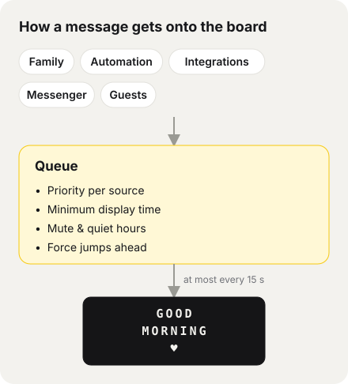

# Gumbel – Handbook

Gumbel is a web app that lets a family (or a team) share one **Vestaboard Note** (3 rows × 15 characters).
Every message goes through **a single queue** with clear rules – nobody simply overwrites someone else's message.

> Kept up to date with every change to the app. You'll also find it in the app under *user menu → Help & handbook*. Technical details on webhooks, templates, and the API: [Integrations documentation](INTEGRATIONS.md). Installation: [step by step](INSTALL.md).

## Contents
1. [Roles and sign-in](#1-roles-and-sign-in)
2. [Compose](#2-compose)
3. [Board / Queue](#3-board--queue)
4. [History](#4-history)
5. [Replies](#5-replies)
6. [Automation](#6-automation)
7. [Integrations](#7-integrations)
8. [Settings](#8-settings)
9. [How the queue decides](#9-how-the-queue-decides)
10. [Operations](#10-operations)

---

## 1. Roles and sign-in

| Role | Sign-in | Can |
|---|---|---|
| **Admin** | Name + password | everything: control the board, Automation, Integrations, Settings, Users, reply to messages |
| **Adults** | Name + password or PIN | compose; depending on permissions: Force, move to front, schedule |
| **Kids** | Name + PIN | compose; optionally with a **Cooldown** between two messages (e.g. 15 min) |

- Permissions per person (under *Settings → Users*): **Force**, **move to front**, **schedule**, each with a default; plus the Cooldown in minutes.
- After several wrong attempts (password or PIN), sign-in from that device is locked – briefly at first, longer on repeat (up to 24 h). Other people and devices can still sign in.
- Admins always sign in with a password (no PIN).
- You stay signed in for 30 days.
- **Privacy:** Non-admins see other people's messages only as "Other message" – neither the content nor the sender. In History they only see their own.
- Top right, in one line: the **bell** (admins only, [quick mute](#8-settings)), **Appearance** – screen = like the system (Auto), sun = light, moon = dark; tap to switch – and the account menu with **Help & handbook** (this handbook inside the app; admins also see the Integrations documentation there).
- Admins see the **current board** centred at the top of every page (except *Board* and *Help*), with a small "Now: source · since 14:30" below. Tapping it opens the Board page.

## 2. Compose

- **Text**: 3 rows of 15 characters. Umlauts become AE/OE/UE (the board doesn't support them). The **preview** shows live how it will look; the counter warns you when it doesn't fit.
- **Symbols**: heart ♥ and the color tiles (red, orange, yellow, green, blue, violet, white, black) via buttons. In the text they appear as `{heart}`, `{red}` …
- **Remove all colors** deletes every color tile from the text.
- **Alignment**: *centered*, *left*, or **Designer** – in Designer mode each row appears on the board exactly as typed, and you paint directly on the preview tiles with color/heart/eraser.
- **Vestaboard art**: ready-made designs (rainbow, heart, waves …) – apply with one tap.
- **Templates**: "Save as template" for your own text and load it again later (also usable for the Alarm). Admins see all templates.
- **When?** *now / next free slot*, *in X minutes*, or *at date/time* (only with the "schedule" permission, at most 30 days ahead).
- **Templates**: at most 100 per person.
- **Options** (depending on permissions): **Force** – gets through Mute/Quiet hours and interrupts the current message; **Move to front** – moves ahead of messages with the same priority.
- **Cooldown** (kids): While the Cooldown is still running you can already compose; sending works as soon as the countdown has finished.

## 3. Board / Queue

**Admin** ("Board"):
- **Now on the board** with source, sender, time on display, and remaining Minimum display time; live indicator.
- Buttons: **Skip**, **Clear board**, **Sync with board** (reads the actual board content). If the board was changed outside Gumbel (e.g. in the Vestaboard app), the sync detects it and archives it as source **External**. If the board is muted in the Vestaboard app, a warning appears.
- **Reply** directly to the current message (see 5), including read status.
- **Status**: last cron run, last successful delivery, last error; a warning if the cron isn't running.
- **Queue** with position and estimated time; per message *Edit*, *Delete*, *Move to front*, *Reply*, **Show now** (immediately, even when muted). Multi-select for bulk actions.
- **Scheduled** (with time), **Upcoming alarms**, failed messages with *Try again*.

**Everyone else** ("Queue"): their own messages in full, other people's as "Other message" with position and approximate wait time. When their own message is showing, it says "Your message is on the board right now!". The page refreshes itself as long as one of their own messages is waiting.

## 4. History

- Log of all messages, grouped by day. Filters: **period** (last hour, today, last 10 days = default, last 30 days, all time) and **status** for everyone; **source** and **person** for admins only.
- Actions: **Send again**, **Use as template** (opens *Compose*), **Restore** (deleted ones), **Delete** (Admin, permanent – with confirmation), **Reply** (Admin).
- Status: showing, shown, expired, deleted, failed.

## 5. Replies

- The admin can reply to a person's message (Board, Queue, or History; at most 300 characters). The reply appears **only in the app**, not on the board.
- The person sees a notice at the top, "… replied", and taps **Read**.
- Below the reply, the admin sees **"not read yet"** or **"✓ read Oct 29, 14:32"**.

## 6. Automation

Admin menu *Automation*, with a pill menu at the top: **Alarm · Clock · Weather · Random pool · News** (green dot = active).
Automation messages join the queue like any other; priority and Quiet hours apply. "… now" buttons show immediately.

**Schedules made of cycles**: Wherever times are involved, you create one or more **cycles** – weekdays + time (or time window). Example: cycle 1 *Mon–Fri 06:30*, cycle 2 *Sat + Sun 08:30*. "+ Add cycle" adds one, × removes it.

- **Alarm**: text (with preview, symbols, Designer, templates), cycles, *active*, *Force* (even when muted). Appears once a day per cycle at the set time; upcoming alarms are listed on the Board page.
- **Pace per cycle**: for Clock, Weather (*Regularly*) and Random pool, each cycle has its days, its time window (from/to) **and its own pace** – "every [hrs] [min]" via two pickers, at least 15 minutes. Example: cycle 1 *Mon–Fri 07–12 every 2 hrs*, cycle 2 *Mon–Fri 12–20 every 45 min*.
- **Clock**: *Digital*, *In words*, or *Date + time*; cycles with time window and pace. Appears on the full interval and expires after 2 minutes (otherwise the time would be wrong).
- **Weather** (Open-Meteo, no account needed): city; **At set times** (cycles with a time, once a day per cycle) or **Regularly** (cycles with time window and pace). Shows city, temperature, conditions, low/high. If fetching fails, it retries every 5 minutes for 30 minutes.
- **Random pool**: one saying per row, each with its own **toggle**, "+ Add saying", × to remove; **heart and colour tiles** via the bar above the list (they go into the saying you tapped last); *+ Example sayings*; plus **Vestaboard art** to switch on/off. **Changes are saved automatically** ("Saved ✓" next to the button); you only need *Save pool* if autosave ever reports that it failed. Never the same one twice in a row. Sayings that are too long are marked red and stay switched off.
- **News**: source *Tagesschau*, *BBC News* or *your own RSS address*; **1–3 headlines**, each as its own message (the source on top, the headline below); cycles with a time, e.g. *Mon–Fri 07:00* and *Sat + Sun 09:00*, once a day per cycle. *Send now* shows them immediately. Priority and Minimum display time under the **News** source in the priority list.
- Long automated texts (e.g. place names) are **shortened** rather than cut off.

## 7. Integrations

*Settings → Integrations*, pill menu **Webhooks · Fetch · NFC**. In short:

- **Webhooks**: Any service that can send webhooks (directly or via Make, Zapier, IFTTT, n8n, Home Assistant) sends data to the webhook URL with an API key.
- **Fetch**: Gumbel regularly fetches a JSON endpoint or an RSS/Atom feed and shows what's new.
- **NFC**: A sticker triggers a fixed message via an iPhone Shortcut.
- **Test mode** only records calls and shows the fields of the last call so you can tap them; from these you build **templates** (`{{field}}`, filters like `|10`, `|eur`, `|datum`), including several **Conditional templates** (e.g. "event equals booking.confirmed").
- Per template **Force**, **display time**, and **expiry**; per integration **Time window**, **Duplicates** protection, **Minimum interval**, optional **HMAC signature**.
- **Delivery log** of the last 50 calls, export/import **Recipes**, **Test now**, **New API key**.

All the details: [Integrations documentation](INTEGRATIONS.md).

## 8. Settings

- **Sprache / Language**: German or English – applies to the interface and board texts (clock in words, weather, example sayings).
- **Users** (separate page): per person name, **role** (Admin, Adult, Kid), sign-in with **password or PIN** (admins always password; password at least 8 characters, PIN 4–8 digits), **source** (sets the priority), permissions *Force*, *move to front*, *schedule* with defaults, *Cooldown* in minutes. After too many failed attempts the list shows **locked** – a new password or PIN lifts the lock. **Deactivate** instead of delete: the person's waiting messages are deleted (restorable in History). At least one active admin always remains.
- **Integrations** (separate page).
- **Messenger** (separate page): messages via **Telegram** or **Slack** to the board, as the **Messenger** source.
  - *Telegram*: create a bot with /newbot at @BotFather, enter the token, *Connect*. Gumbel asks for new messages every minute (also works at home without a public address). Whoever writes to the bot appears as a **request** and is **approved** once (or *rejected*; *Check now* fetches new messages right away); private chats only, no groups. The bot confirms every message (e.g. “✓ In the queue (position 2)”). *Remove* withdraws the approval, *Disconnect* deletes token and approvals.
  - *Slack*: create an app at api.slack.com/apps, a slash command (e.g. `/board`) with the request URL shown, enter the signing secret, *Slack active*. Needs a publicly reachable installation with HTTPS; every request is verified by signature.
  - For both: *pause per person* and *expires after*. Texts that are too long are shortened. Signal and WhatsApp have no official bot interface.
- **Mailbox** (separate page): friends and guests send a message **without an account** – via a secret link or QR code (download as SVG, print view to hang up). Guests can only write text, colors and hearts and optionally give their name (only the admin sees it). Settings: *move to front*, *guests may use Force*, *pause per device*, *max. per hour*, *max. waiting*, *expires after*. Priority and Minimum display time are set for the **Guests** source in the priority list. *Create new link* invalidates old links and printed QR codes immediately; when switched off, the link only shows “Mailbox closed”. Guest messages can be deleted like any other; there are no replies for guests.
- **Board connection** (separate page): **Cloud API** (default, works everywhere) or **Local API** (directly on your home network, without the Vestaboard cloud, faster – only if Gumbel runs on the same network, e.g. via Docker or Raspberry Pi). For the Local API, request an enablement token at vestaboard.com/local-api, then enter the board's address (IP) and the token – Gumbel fetches the permanent key once. *Test connection* reads the board once. A token in `config.php` or `VESTABOARD_TOKEN` takes precedence over the field in the UI.
- **Custom sources**: create additional sources (e.g. "Bookings", "Home Assistant") to give integrations their own priority and their own Minimum display time. You can delete one as soon as no integration uses it anymore.
- **Priority & Minimum display time**: sort sources by dragging (or with the arrows) – top = more important. Per source, the minimum time a message stays up before the next one comes.
- **Interrupt**: these sources may end the Minimum display time of *other* sources (default: Alarm, Admin) – not against the same source and not against Force messages that are showing.
- **Mute**: off / on / on until a set time; plus **always mute individual sources**. Force gets through – except with **completely silent**, then Force messages wait too.
- **Quick mute** (admins, bell at the top right of every page): "Mute the board for …" *30 min*, *1 hr*, *2 hrs*, *4 hrs*, a **custom duration** (0.5–48 hrs, type a number → *hrs muted*) or *until I end it*, optionally **completely silent**. While muted, everyone sees a yellow notice; the bell is crossed out. *End mute* switches back immediately, then the queue is worked through (expired messages lapse as usual).
- **Quiet hours**: recurring time windows (e.g. daily 22:00–07:00), several possible.
- **Force**: all messages or specific sources always as Force.
- **Idle screen** (default after 30 minutes): what happens after X minutes with nothing new – *keep the last message*, *clear the board*, or *show a fixed text*.

## 9. How the queue decides

Only one component sends to the board (the "arbiter"). It runs every minute and immediately after every new message.

1. Expired messages drop out; scheduled ones wait until their time.
2. During Mute/Quiet hours only **Force** messages get through; the others wait.
3. **Force** is shown immediately (if a Force message is already showing, priority decides).
4. Otherwise the current message waits out its **Minimum display time** – unless a source with "Interrupt" arrives.
5. After that the winner is: **higher priority → moved to front → oldest first**.
6. The Vestaboard accepts something at most every 15 seconds; errors are retried up to three times.

Messages from integrations can bring their **own display time** (configurable per template).

**Default priority and Minimum display time** (changeable under *Settings*): Alarm 5 min · Admin 10 · Adults 10 · Kids 5 · NFC 5 · Weather 5 · Clock 2 · Webhook 5 · Social media 3 (webhook source for social media services) · Fetch 5 · Random pool 5 · News 3 · Guests 5 · Messenger 5 – plus custom sources.

## 10. Operations

- **Installation** step by step (Docker Desktop, Synology, Raspberry Pi, web hosting): [INSTALL.md](INSTALL.md). First setup in two steps: create the admin, connect the board.
- Docker: SQLite in the `gumbel-data` volume, the cron runs inside the container. Web hosting: PHP 8.2+ with current security updates (at least 8.2.35 / 8.3.36 / 8.4.27 / 8.5.12; otherwise admins see a security warning on the Board page) with MariaDB/MySQL or SQLite, cron job **every minute** on `cron.php` (board sync, Automation, fetches, Telegram, arbiter).
- Preferably on the command line: `php public/cron.php` (no key needed). Via URL only with the key – better as `X-Cron-Key` header than `?key=` (which ends up in logs). If a run is still busy, the next one is skipped.
- Database changes run automatically on the first page load (migrations).
- **Security:** the document root must be `public/` (nginx ignores `.htaccess`). Behind a reverse proxy, enter its IP and force HTTPS when the proxy terminates TLS: Docker `GUMBEL_TRUSTED_PROXIES` / `GUMBEL_FORCE_HTTPS`, web hosting `trusted_proxies` / `force_https` in `config/config.php`. Strict Content Security Policy, no inline scripts.
- Tests: see [README](../../README.md).
