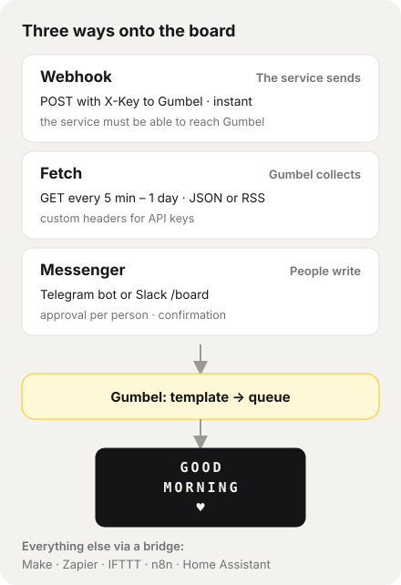
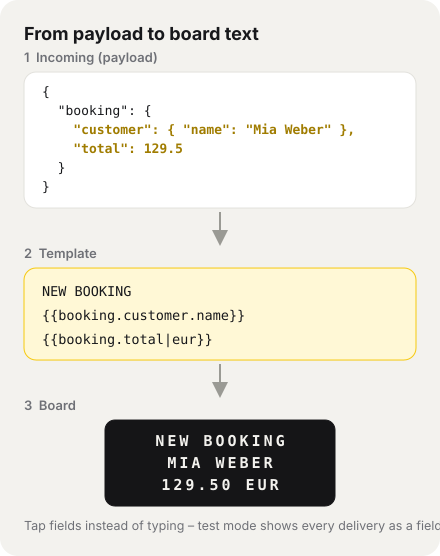

# Gumbel – Integrations

How other services, devices and people get text onto the Vestaboard: via **webhook**, via **fetch** (JSON/RSS), via **NFC sticker** or via **messenger** (Telegram, Slack).
Everything is set up in the app under *Settings → Integrations* or *Settings → Messenger* – no programming needed on the Gumbel side.

> Kept up to date with every change. In the app under *User menu → Help & handbook → Integrations*. Overview of the whole app: [Handbook](HANDBOOK.md).

## Contents
1. [Overview](#1-overview)
2. [Which way fits my service?](#2-which-way-fits-my-service)
3. [Quick start: a webhook in 5 minutes](#3-quick-start-a-webhook-in-5-minutes)
4. [Connect your service: step by step](#4-connect-your-service-step-by-step)
5. [Webhook API](#5-webhook-api)
6. [Templates, placeholders, and filters](#6-templates-placeholders-and-filters)
7. [Conditional templates](#7-conditional-templates)
8. [Options: Force, display time, expiry](#8-options-force-display-time-expiry)
9. [Time window, duplicates, minimum interval](#9-time-window-duplicates-minimum-interval)
10. [Test mode and delivery log](#10-test-mode-and-delivery-log)
11. [Security: API key and HMAC signature](#11-security-api-key-and-hmac-signature)
12. [Fetch: JSON and RSS](#12-fetch-json-and-rss)
13. [NFC stickers (iPhone)](#13-nfc-stickers-iphone)
14. [Messenger: Telegram and Slack](#14-messenger-telegram-and-slack)
15. [Recipes: ready-made collection, export and import](#15-recipes-ready-made-collection-export-and-import)
16. [Examples](#16-examples)
17. [Limits and how to work around them](#17-limits-and-how-to-work-around-them)
18. [Troubleshooting](#18-troubleshooting)
19. [For developers: adding a new module](#19-for-developers-adding-a-new-module)

---

## 1. Overview



- **Webhook – the service sends.** On an event (new booking, server down, washing machine done) it calls Gumbel's webhook URL. Arrives instantly. Requirement: the service can reach Gumbel (see [Limits](#17-limits-and-how-to-work-around-them)).
- **Fetch – Gumbel collects.** Gumbel queries an address on a fixed schedule (5 min – 1 day): a JSON API or an RSS/Atom feed. Also works when Gumbel runs at home without a public address.
- **Messenger – people write.** Approved people message your own Telegram bot or use `/board text` in Slack.
- Plus: **NFC stickers** (one tap with the iPhone triggers a fixed text) and the **mailbox** for guests without an account (see [Handbook](HANDBOOK.md)).

What ends up on the board is decided by the **template** in Gumbel: a service sends any data, you pick the fields. The message then **joins the queue** – nothing gets overwritten, texts that are too long are **shortened** instead of rejected. Each integration has a **source** (e.g. *Webhook*, *Fetch (feed)*, *NFC*, *Messenger* or a **custom source**), and the source sets the priority and Minimum display time in Settings.

## 2. Which way fits my service?

Ask yourself in this order:

| Question | Yes → | Examples |
|---|---|---|
| Is there a **ready-made recipe**? | *Integrations → Webhooks/Fetch → Ready-made recipes → Add* | Tagesschau, BBC, Bitcoin, GitHub, Uptime Kuma, Shopify, Home Assistant |
| Can the service **send webhooks** (setting "webhook", "notify URL", "HTTP request" – via **POST**)? | **Webhook** ([way A](#way-a-the-service-can-send-webhooks)) | booking systems, Shopify, GitHub, Uptime Kuma, Home Assistant, your own scripts |
| Does the service have a **JSON API** or an **RSS feed** you can query by address? | **Fetch** ([way B](#way-b-the-service-has-an-api-or-a-feed)) | news, prices, sensor values, project stats, football |
| Is the service available on **Make, Zapier, IFTTT or n8n**? | **Bridge** ([way C](#way-c-bridge-via-make-zapier-ifttt-or-n8n)) | Google Calendar, Gmail, Outlook, Trello, Notion, Spotify, Instagram |
| Should **people** send something (without an app account)? | **Messenger** or **mailbox** ([way D](#way-d-people-write-telegram-slack-mailbox)) | family on the go, colleagues, guests |
| A **fixed text at the push of a button**? | **NFC sticker** ([section 13](#13-nfc-stickers-iphone)) | "DINNER IS READY" on the kitchen door |

Rule of thumb: **webhook before fetch** (instant instead of on a schedule, no unnecessary requests). **Fetch** when the service can't send anything – or Gumbel isn't reachable at home.

## 3. Quick start: a webhook in 5 minutes

1. *Integrations → Webhooks → + New webhook*, give it a name, choose a source, create it.
2. Copy the **webhook URL** and **API key** (the key is only shown now) and enter them in the service: method `POST`, header `X-Key: <key>`.
3. Turn on **Test mode** for the webhook, save, trigger it once in the service.
4. Under "Last call" all fields appear – tapping one inserts placeholders like `{{booking.customer.name}}` into the template. The preview shows the real result.
5. Turn Test mode off, save. Done.

Try it without a service – with `curl` in a terminal:

```bash
curl -X POST "https://<your-domain>/api/inbound.php" \
  -H "Content-Type: application/json" -H "X-Key: <key>" \
  -d '{"text": "HELLO FROM THE TERMINAL"}'
```

## 4. Connect your service: step by step

### Way A: the service can send webhooks

1. **In Gumbel:** *Integrations → Webhooks → + New webhook*. As source, *Webhook* or a custom source (e.g. "Bookings", created under *Settings → Custom sources*) – that gives the service its own priority and Minimum display time.
2. **In the service**, create the webhook. What you need there:
   - **URL:** the webhook URL shown (`…/api/inbound.php`).
   - **Method:** `POST`. **Format:** JSON (`application/json`) – form data (`application/x-www-form-urlencoded`) works too.
   - **Key:** ideally as header `X-Key`. If the service can't set custom headers (e.g. GitHub, Shopify), append it to the URL: `…/api/inbound.php?key=<key>` (that ends up in the server log, so prefer the header).
   - If you program the sender yourself (script, n8n/Make with a code step), you can use the [HMAC signature](#11-security-api-key-and-hmac-signature). GitHub's, Stripe's or Shopify's own signatures aren't recognised – the key is enough there.
   - If the service retries on errors (many do), enter an event ID as the **duplicate key** (e.g. `{{id}}`) so nothing shows up twice.
3. Turn on **Test mode** and trigger a test in the service (many have "send test notification"). Under *Last call* you now see all fields (the last call is always stored; Test mode only keeps it off the board).
4. **Build the template:** tap fields. For different events create **Conditional templates** (e.g. `event` *equals* `order.paid` → `PAID {green}`). Hide unimportant ones with an empty template.
5. **Fine-tuning:** Force for important things, time window (e.g. not at night), duplicate protection, Minimum interval.
6. **Turn Test mode off.** From now on, every event joins the queue; the Delivery log shows the last 50 deliveries.

### Way B: the service has an API or a feed

1. **Find the address:** look in the service's API docs for an address that returns JSON via **GET** (often "REST API", "endpoint", "/v1/…"). For news and blog sites, the **RSS feed** is enough (📶 icon or "RSS" on the site).
2. **Key?** Many APIs require an API key. Here's how to enter it:

   | The API docs say … | In Gumbel |
   |---|---|
   | "header `Authorization: Bearer <token>`" | **Custom headers:** `Authorization: Bearer YOUR-TOKEN` |
   | "header `X-Api-Key` / `X-Auth-Token` …" | **Custom headers:** `X-Api-Key: YOUR-KEY` |
   | "parameter `?apikey=…` / `&appid=…`" | directly in the **address** (recipe export turns it into `YOUR-KEY`) |
   | "Basic auth" (user + password) | **Custom headers:** `Authorization: Basic <base64 of user:password>` (not `user:pass@` in the address) |
   | "OAuth", "sign in with Google/Microsoft" | not possible directly → [way C](#way-c-bridge-via-make-zapier-ifttt-or-n8n). Many services also offer a **personal token** (GitHub personal access token, Notion internal integration, Home Assistant long-lived token) – that works as `Authorization: Bearer …`. |

   **Test first:** open the address in a browser (Firefox shows JSON as a tidy tree) or with `curl -H "X-Api-Key: …" "https://…"`. Read off the path to the value you want – levels with dots, lists by index (`data.0.temperature`). Careful: some APIs answer errors with HTTP 200 and an error message as JSON – that then ends up as the payload.
3. **In Gumbel:** *Integrations → Fetch → + New fetch*, enter address, schedule (5 min – 1 day) and any custom headers, create it. The address is fixed – variables like today's date aren't possible.
4. **Fetch now** – the response shows up as a field list. Errors (wrong key → HTTP 401/403, wrong address → 404) appear in the Delivery log.
5. **Build the template** as with webhooks, e.g. `{{data.temperature|number}} DEGREES`. Lists by index: `{{items.0.title}}`, `{{results.0.name}}`.
6. **Turn Test mode off.** Gumbel now fetches on schedule – and only shows something when the text has **changed**.

Tip: fetch rarely (e.g. every hour) – many free APIs have a daily limit. For headlines at **set times** (e.g. at 7 in the morning), *Automation → News* is a better fit than a fetch.

### Way C: bridge via Make, Zapier, IFTTT or n8n

For services with a login (Google, Microsoft, Spotify, Instagram …) or without their own webhooks: the bridge handles the sign-in and sends Gumbel a webhook.

1. Create a **webhook** in Gumbel (way A, steps 1–3).
2. In the bridge, a scenario: the service's **trigger** (e.g. "new event in Google Calendar", "new email with label …") → action **HTTP request / webhook**:
   - Make: module *HTTP → Make a request*; Zapier: *Webhooks by Zapier → POST*; IFTTT: *Webhooks → Make a web request*; n8n: node *HTTP Request*.
   - URL = webhook URL, method POST, header `X-Key`, JSON body, e.g. `{"text": "{{Title}}", "start": "{{Start}}"}`.
   - Note: Zapier (*Webhooks*) and IFTTT (*Additional Headers*) need a paid plan for this; if needed append the key as `?key=` to the URL. Make and n8n work for free.
3. Build the template in Gumbel, e.g. `EVENT` / `{{text|15}}` / `{{start|time}}` (all-day events give "00:00" with `|time` – add a condition for those).

### Way D: people write (Telegram, Slack, mailbox)

- **Telegram:** your own bot, approval per person – [section 14](#14-messenger-telegram-and-slack). Also works without a public address.
- **Slack:** slash command `/board text` – [section 14](#14-messenger-telegram-and-slack). Needs a publicly reachable installation.
- **Mailbox:** secret link or QR code, guests write without an account – see [Handbook](HANDBOOK.md).

## 5. Webhook API

**Endpoint:** `POST https://<your-domain>/api/inbound.php`

**Headers**

| Header | Required | Content |
|---|---|---|
| `X-Key` | yes | API key of the integration. Order: header `X-Key`, otherwise `?key=` in the URL (only for services that can't send custom headers, like GitHub or Shopify; ends up in the server log), otherwise the `key` field in the body |
| `Content-Type` | recommended | `application/json` or `application/x-www-form-urlencoded` (none = form data) |
| `X-Timestamp`, `X-Signature` | only with HMAC | see [section 11](#11-security-api-key-and-hmac-signature) |

**Body** – anything. These fields have a fixed meaning:

| Field | Meaning |
|---|---|
| `text` | shown when the default template is empty |
| `force` | `true` = Force, only if "Allow Force via payload" is on |
| `expires_in_min` | expiry in minutes (1–1440), if the template is set to "Default" |

At most 64 KB; JSON or form data only, `POST` only.

**Responses**

| HTTP | Body | Meaning |
|---|---|---|
| 200 | `{"ok": true, "message_id": 123}` | queued |
| 200 | `{"ok": true, "message_id": 123, "held_until": "2026-10-30 07:00:00"}` | outside the time window, appears later (UTC) |
| 200 | `{"ok": true, "ignored": true}` | not shown (no template matches, "don't show", or duplicate) |
| 200 | `{"ok": true, "test": true, "text": "…"}` | Test mode: only recorded; `text` = what would be shown |
| 400 | `{"ok": false, "error": "Invalid JSON."}` | broken body |
| 401 | `{"ok": false, "error": "…"}` | key missing/wrong, integration off, invalid signature |
| 405 | `{"ok": false, "error": "Only POST allowed."}` | not POST (e.g. a device that calls the URL via GET) |
| 413 | `{"ok": false, "error": "…"}` | body larger than 64 KB |
| 415 | `{"ok": false, "error": "…"}` | Content-Type other than JSON/form |
| 429 | `{"ok": false, "error": "…"}` | Minimum interval not reached, or 20 messages from this source are already waiting |
| 500 | `{"ok": false, "error": "Internal error"}` | error in Gumbel (see the server log) |

Recommendation for senders: timeout ~3 s, send in the background, on 429 retry at most once later.

## 6. Templates, placeholders, and filters



- `{{field.path}}` inserts a value from the payload – nested with dots, lists by index: `{{items.0.title}}`. If the whole response is a list, the path starts with the index: `{{0.name}}`.
- Missing fields become empty. `true/false` become `YES/NO` (in German `JA/NEIN`). Upper case happens on the board.
- The field list shows up to 60 fields; very large responses are shortened in the recording (long texts and lists), but the fields stay tappable.
- Colour tiles and heart as everywhere: `{heart}`, `{red}` …
- **Empty default template** = the `text` field from the payload.

**Filters** (after `|`, combinable, applied left to right; the German names `zahl`, `datum`, `zeit`, `oder:` work too):

| Filter | Example | Result |
|---|---|---|
| number = shorten to that many characters (at word boundaries) | `{{name\|8}}` | `Anna Miller` → `ANNA` |
| `number` | `{{total\|number}}` | `1234.5` → `1,234.50` |
| `eur` | `{{total_gross\|eur}}` | `289` → `289 EUR` |
| `date` | `{{start\|date}}` | `2026-11-12T13:00:00Z` → `Nov 12` (ISO date or Unix seconds) |
| `time` | `{{start\|time}}` | → `14:00` (local time = configured time zone) |
| `or:TEXT` | `{{booking.time\|or:ALL DAY}}` | fallback if empty |

Example: `{{title}}` / `{{booking.customer.short|15}}` / `{{booking.date}} {{booking.time|or:}}`

**Time zone:** local time, time windows and cycles follow the configured time zone – Docker: variable `TZ` in `docker-compose.yml`, web hosting: `timezone` in `config/config.php` (default `Europe/Berlin`).

**Shortening:** if the result doesn't fit 3 × 15, Gumbel shortens it automatically: line breaks (paragraphs) are kept, each paragraph gets at least one line, spare lines go to the paragraph that needs them; cuts happen at word boundaries (umlauts count double: Ü = UE).

## 7. Conditional templates

Besides the default template, any number (up to 10) of **Conditional templates**:

> **If** `event` *equals* `booking.confirmed` → `BOOKED {heart}` / `{{booking.customer.short}}`

- Comparisons: **equals**, **contains**, **exists** (case-insensitive; compare `true`/`false` as text).
- The **first match** wins (order = top to bottom). No match → default template.
- **Empty template = don't show** (e.g. for ping or test events).
- Each template has its own preview using the last delivery; "matches last call" shows which one would apply.

## 8. Options: Force, display time, expiry

Per template (default and each conditional one):

| Option | Effect |
|---|---|
| **Force** | gets through Mute/Quiet hours, interrupts messages that are showing (except with "completely silent") |
| **Display time** | Minimum display time of this message (1–30 min) instead of the source's |
| **Expires after** | how long it may wait (15 min – 24 h); "Default" = 60 min or `expires_in_min` |

Example booking system: booking with Force and 10 min display, inquiry normal, cancellation 2 min.

## 9. Time window, duplicates, minimum interval

- **Time window** (per integration, cycles of days + from/to): outside it, the message is **held back** and appears as soon as the next window starts; expiry counts from then. Without a time window: always.
- **Duplicates**: duplicate key as a template, e.g. `{{event}}-{{booking.number}}`, plus a period (10 min – 7 days). Same key within the period → ignored (status "duplicate").
- **Minimum interval**: none / 10 s / 1 / 5 / 15 min between two messages of this integration. Webhooks default to *none*, NFC to *1 min* (double taps).
- **Flood protection**: at most 20 waiting messages per source, beyond that 429.

## 10. Test mode and delivery log

- **Test mode**: deliveries are stored and evaluated, but nothing goes to the board; Minimum interval, time window and duplicate check are skipped. The response contains `"test": true` and the text. Imported recipes start in Test mode.
- **Last call**: all fields to tap + raw data (JSON).
- **Test now**: fills the matching template with the last delivery and queues it right away.
- **Delivery log**: the last 50 deliveries per integration with status, text, template used, note and payload.

| Status | Meaning |
|---|---|
| queued | in the queue |
| held | outside the time window, appears later |
| Test mode | only recorded |
| ignored | no matching template / "don't show" |
| duplicate | same duplicate key within the period |
| error | signature, Minimum interval, queue full, fetch failed |

A fetch without anything new isn't logged (*Fetch now* says "nothing new").

## 11. Security: API key and HMAC signature

- **API key**: per integration, 48 characters, stored only as a SHA-256 hash. It's shown once on creation; lost it → **New API key** (the old one stops working immediately). Always send via HTTPS. The key is never stored in the Delivery log.
- **HMAC signature** (optional, for senders you build yourself – GitHub's, Stripe's or Shopify's signature schemes aren't recognised): protects against forged and replayed deliveries.
  1. *Security & rate → Generate signing secret* (starts with `whsec_`, shown only once).
  2. In the sender: `X-Timestamp` = Unix time in seconds, `X-Signature` = `sha256=` + HMAC-SHA256 over `"<timestamp>.<raw body>"` with the secret (hex).
  3. Turn on "Require HMAC signature". Timestamps older than 5 minutes are rejected.
- **Custom headers for fetching** (other services' API keys) are never shown again, never exported, and only sent to the address you entered – not to redirects to another host or from HTTPS to HTTP.

```js
// Node.js
import crypto from 'node:crypto';
const body = JSON.stringify(payload);
const ts = Math.floor(Date.now() / 1000).toString();
const sig = 'sha256=' + crypto.createHmac('sha256', process.env.GUMBEL_SECRET).update(`${ts}.${body}`).digest('hex');
await fetch(URL, { method: 'POST', body, headers: { 'Content-Type': 'application/json', 'X-Key': process.env.GUMBEL_KEY, 'X-Timestamp': ts, 'X-Signature': sig }, signal: AbortSignal.timeout(3000) });
```

```php
// PHP
$body = json_encode($payload);
$ts = (string) time();
$sig = 'sha256=' . hash_hmac('sha256', $ts . '.' . $body, getenv('GUMBEL_SECRET'));
// Headers: X-Key, X-Timestamp: $ts, X-Signature: $sig
```

```bash
# curl
BODY='{"text":"HELLO"}'; TS=$(date +%s)
SIG="sha256=$(printf '%s' "$TS.$BODY" | openssl dgst -sha256 -hmac "$GUMBEL_SECRET" | sed 's/^.* //')"
curl -X POST "$URL" -H "Content-Type: application/json" -H "X-Key: $GUMBEL_KEY" -H "X-Timestamp: $TS" -H "X-Signature: $SIG" -d "$BODY"
```

## 12. Fetch: JSON and RSS

*Integrations → Fetch → + New fetch*: address and schedule (5 min – 1 day).

- **JSON**: the response is the payload – fields as with webhooks.
- **RSS 2.0/Atom** (not RSS 1.0/RDF): Gumbel turns it into `feed` (feed title), `title`, `description` (max. 300 characters), `link`, `date` (ISO, works with `|date`) of the newest entry and `items.0` … `items.4` with the same fields.
- **Custom headers** for services with an API key: one header per line, e.g. `Authorization: Bearer abc123` or `X-Api-Key: abc123` (max. 5). Saved values are never shown again (••••••); to change one, simply enter it again. If the address's host changes, the values must be entered again. If it says `YOUR-KEY` (from a recipe), your key is still missing.
- **Fetch now** shows the fields right away. **The same text as last time is not repeated** – only new content appears. Values that change all the time (prices) therefore appear on every fetch – choose the schedule accordingly.
- Templates, conditions, options, time windows, and duplicates work as with webhooks.
- Example: `https://www.tagesschau.de/index~rss2.xml` with template `{{feed|15}}` / `{{title}}`.
- Public http(s) addresses only (no devices on your home network), ports 80/443/8080/8443, IPv4 only, max. 3 redirects (each one is checked), max. 512 KB, 8 s time limit. Errors show up in the Delivery log.

## 13. NFC stickers (iPhone)

1. *Integrations → NFC → + New sticker*: name, text (with preview), create; copy the key.
2. **Shortcuts** app **→ Automation → + → NFC**, scan the sticker, "Run Immediately".
3. Action **"Get Contents of URL"**: webhook URL, *Show More* → method **POST**, header `X-Key` = key.
4. Hold the phone to the sticker. The default Minimum interval of 1 min prevents double triggers.

Android: the same with an app like *HTTP Shortcuts* or *Tasker* (POST to the webhook URL, header `X-Key`).

## 14. Messenger: Telegram and Slack

*Settings → Messenger.* Messages appear as the **Messenger** source (priority and Minimum display time in the priority list). For both, *pause per person* and *expires after* apply; texts that are too long are shortened.

**Telegram** (also works at home without a public address – Gumbel checks every minute):
1. In Telegram, open **@BotFather**, send `/newbot`, choose a name and username. You get a **bot token** (`123456789:AAH…`).
2. Enter the token in Gumbel → *Connect*.
3. Send your bot a message in Telegram. Within a minute (or right away with *Check now*) you appear under **Requests** → *Approve* (or *Decline*). The bot confirms the approval.
4. Now send any text to the bot – it replies e.g. "✓ In the queue (position 2)". Family and friends the same way: share the bot's name, approve the request.

Good to know: private chats only (no groups), text only (for photos/stickers the bot asks for a text), at most 30 approvals and 10 open requests; unknown senders end up as a request (which expires after 7 days). *Remove* withdraws an approval, *Disconnect* deletes the token and all approvals.

**Slack** (needs a publicly reachable installation with HTTPS):
1. Create an app at [api.slack.com/apps](https://api.slack.com/apps) ("From scratch").
2. *Slash Commands → Create New Command*: command e.g. `/board`, **Request URL** = the address shown in Gumbel (`…/api/slack.php`).
3. Copy *Basic Information → Signing Secret*, enter it in Gumbel, turn on *Slack active*, save. Install the app in your workspace.
4. In Slack: `/board Hello everyone`. Only the sender sees the reply.

Every Slack request is verified by signature (older than 5 minutes → rejected). Everyone in the workspace may post – Slack has no per-person approval. **Signal** and **WhatsApp** have no official bot interface and are therefore not supported.

## 15. Recipes: ready-made collection, export and import

**Ready-made recipes** (under *Webhooks* or *Fetch* → *Ready-made recipes*) are added with one click:

| Recipe | Type | Needs |
|---|---|---|
| Tagesschau, BBC News, Hacker News | Fetch (RSS) | – |
| Bitcoin price (CoinGecko), air quality (Open-Meteo) | Fetch (JSON) | – (adjust coordinates/coin in the address) |
| GitHub stars | Fetch (JSON) | – (adjust owner/repo; optional token in the `Authorization` header) |
| Next football match (football-data.org) | Fetch (JSON) | free API key in the `X-Auth-Token` header |
| Dad joke (icanhazdadjoke) | Fetch (JSON) | – |
| Uptime Kuma (down in red + Force, back up in green) | Webhook | `X-Key` header in Uptime Kuma |
| GitHub: new star, Shopify: new order | Webhook | key via `?key=` in the URL |
| Home Assistant | Webhook | see [Examples](#16-examples) |

Recipes start in **Test mode**; fetch recipes additionally **switched off** until you've checked address and key and activated the integration. New recipes live as JSON in the `recipes/` folder – contributions welcome. Texts may be bilingual (`{"de": "…", "en": "…"}`).

- **Export recipe** downloads a JSON file with name, source, templates, conditions, options, time window, duplicate rule, Minimum interval, and fetch address – **without** keys, secrets, and the Delivery log. Of custom headers only the names are exported; keys in the address (`?apikey=…`, `&token=…`) become `YOUR-KEY`.
- **Import recipe** (file or pasted JSON) creates a new integration with its own key – in Test mode as above.
- Format: `{"format": "gumbel-integration", "version": 1, …}` – for sharing with the community.

## 16. Examples

**Booking system** (own sender, custom source "Bookings", `event` = `inquiry.created` / `booking.confirmed` / `booking.cancelled`, payload with `title`, `test`, `booking.*`):
- Condition 1: `test` *equals* `true` → empty (don't show tests) or `TEST {{title}}`.
- Condition 2: `event` *equals* `booking.confirmed` → `BOOKED {heart}` / `{{booking.customer.short|15}}` / `{{booking.date}} {{booking.time|or:}}` · Force · 10 min.
- Condition 3: `event` *contains* `cancel` → `CANCELLED` / `{{booking.customer.short|15}}` / `{{booking.date}}` · 2 min.
- Default: `{{title}}` / `{{booking.customer.short|15}}` / `{{booking.date}}`.
- Duplicates: `{{event}}-{{booking.number}}`, 1 h. Minimum interval: none. Time window e.g. Mon–Sun 07:00–22:00.

**Make / Zapier / n8n**: trigger (e.g. "new event in Google Calendar") → module *HTTP* / *Webhooks by Zapier (POST)* → URL, header `X-Key`, JSON body with the fields you want. Build the template in Gumbel.

**Home Assistant** (`configuration.yaml`):
```yaml
rest_command:
  vestaboard:
    url: "https://<your-domain>/api/inbound.php"
    method: POST
    headers:
      X-Key: !secret gumbel_key
    content_type: "application/json"
    payload: '{{ {"event": event, "text": message} | to_json }}'
```
Call it in an automation: `action: rest_command.vestaboard` (older versions: `service:`) with `data: {event: "washer", message: "LAUNDRY DONE"}`. `to_json` makes quotes in the text work too. If Gumbel runs on the same home network, use `http://<Gumbel's IP>:8080/api/inbound.php` as the URL – Gumbel always shows `https://…`, adjust it by hand.

The other way round (Gumbel queries Home Assistant) only works if Home Assistant is publicly reachable via HTTPS on port 443 (e.g. via Nabu Casa): fetch `https://…/api/states/<entity_id>` with header `Authorization: Bearer <long-lived token>`, template `{{state}}`. The default port 8123 and addresses on your home network are blocked.

**IFTTT**: action *Webhooks → Make a web request*, method POST, content type `application/json`, header `X-Key` (under "Additional Headers"), body e.g. `{"text": "{{Value1}}"}`.

**Your own script** (e.g. a cron job that checks backups): see the `curl` example in the [quick start](#3-quick-start-a-webhook-in-5-minutes) – or Node.js/PHP with a signature in [section 11](#11-security-api-key-and-hmac-signature).

## 17. Limits and how to work around them

| Limit | Why | Workaround |
|---|---|---|
| **Webhook only via POST with JSON or form data.** Devices that call a "notification URL" via GET (some routers, Shelly) get 405; `text/plain`, XML or file uploads 415. | One clearly defined entry point. | A bridge or a small script in between. |
| **No verification handshake.** Services that expect an answer to a challenge request during setup (Slack Events, Meta/Strava `hub.challenge`, Microsoft Graph) can't be set up directly. | Gumbel always answers the same way. | Bridge ([way C](#way-c-bridge-via-make-zapier-ifttt-or-n8n)). |
| **Webhooks need reachability.** If Gumbel runs at home (Docker, Pi), services on the internet can't reach it. | Routers and home networks don't let calls in from outside. | Use fetch or Telegram (both collect by themselves) · set up a tunnel (e.g. Cloudflare Tunnel, Tailscale Funnel) · run Gumbel on web hosting · services on your home network (Home Assistant) can reach Gumbel directly. |
| **Fetch can't reach devices on your home network** (192.168.…, `localhost`, `.local`). | Protection against Gumbel being used to probe internal services. | Let the device send a webhook itself (Home Assistant, script). |
| **No OAuth / "sign in with Google".** | Such access expires and has to be renewed. | Bridge via Make/Zapier/IFTTT/n8n ([way C](#way-c-bridge-via-make-zapier-ifttt-or-n8n)). |
| **Fetch only does GET** – no POST requests, no GraphQL, no signed requests (e.g. AWS), no variables in the address (e.g. today's date), IPv4 only. | Deliberately kept simple. | A bridge (n8n, Make) collects the data and sends a webhook. |
| **No loops over lists.** | Templates are fixed texts with placeholders. | Use fixed indexes (`{{items.0.title}}`, `{{items.1.title}}`) or several templates. |
| **RSS: only the first 5 entries**, only RSS 2.0 and Atom; the newest is shown when it changes. | The board only shows one message anyway. | For 1–3 headlines at set times: *Automation → News*. |
| **Sizes:** webhook body 64 KB, fetch response 512 KB, 8 s time limit, max. 3 redirects, ports 80/443/8080/8443. | Protection against overload. | Send fewer fields from the service or pick a leaner address. |
| **Schedule:** fetches at most every 5 minutes, Telegram every minute. | Friendly to free APIs and to the cron. | For "instant": webhook. |
| **Board:** 3 lines × 15 characters, only letters, digits, some symbols and colour tiles; umlauts become AE/OE/UE; no images. | That's how the Vestaboard Note works. | Short templates, filter `\|15` to shorten. |
| **Pace:** at most one message every 15 seconds, at most 20 waiting per source. | Vestaboard's limit / flood protection. | Set duplicates and Minimum interval, hide unimportant events via conditions. |
| **One board, one queue, one time zone.** | Gumbel is built for one board. | Time zone via `TZ` (Docker) or `timezone` (config.php). |
| **Calendars (iCal) aren't read directly.** | Recurrences and time zones make iCal complex. | Bridge ("new event" → webhook). |

## 18. Troubleshooting

| Problem | Solution |
|---|---|
| Service reports **401** | Wrong key or integration off. The header is called exactly `X-Key`; with `?key=` copy the full URL. |
| Service reports **415** or **400** | Set the format to JSON (`application/json`) or form data; check the JSON for typos. |
| Delivery arrives but **nothing shows** | Check the Delivery log: *Test mode* still on? *ignored* (no template matches / empty template)? *held back* (time window)? *duplicate*? Board muted (bell)? |
| **Fetch: "not publicly reachable"** | The address points into your home network or the name is unknown – see [Limits](#17-limits-and-how-to-work-around-them). |
| **Fetch: HTTP 401/403** | Key missing or wrong – enter it again under *Custom headers* (`YOUR-KEY` means it's still missing). |
| **Fetch: "response is neither JSON nor RSS/Atom"** | The address returns a web page. Look in the API docs for the JSON address or for the RSS feed. |
| **Fetch never happens** | Is the cron running (the Board page shows the last check)? Is the integration **active**? Recipes with a fetch address arrive switched off. |
| Service disables the webhook (e.g. Shopify, GitHub) | It got errors too often (413/429/401). Check the Delivery log, fix the cause, re-enable it in the service. |
| Text gets **cut off** | Shorten the template, use the `\|15` filter, set lines deliberately (Enter = new line). |
| **Telegram:** no request appears | Did you really message your bot (username from @BotFather)? Tap *Check now*. Is the cron running (the Board page shows the last check)? |
| **Slack:** "dispatch_failed" / timeout | Gumbel isn't reachable from outside via HTTPS, or *Slack active* is off. |

## 19. For developers: adding a new module

1. Without code: *Settings → Custom sources* – a custom source is immediately available for webhooks and fetches. With code: `src/Sources.php`, add a built-in source (`label`, `duration`). Both appear automatically in the priority list.
2. `src/Inbound.php`, `MODULES`: assign the source to a module or add your own module – `label`, `title`, `sources`, `kind` (`webhook` | `pull` | `nfc`), `help`, `min_interval`, texts. The page builds the pill menu, list, form, and instructions from it.
3. Building blocks: `WebhookTemplate` (templates, filters, conditions), `Feed` (fetching, headers, SSRF protection), `Inbound` (flow, Delivery log, recipes, HMAC), `Messenger` (Telegram/Slack), `RecipeBook` (bundled recipes), `IntegrationView` (rendering), `Charset::fit()` (shortening).
4. Contribute a recipe: set up the integration, *Export recipe*, make texts bilingual if needed, submit as `recipes/<name>.json` via pull request.
5. Tests: `tests/inbound-test.php`, `tests/recipes-test.php`, `tests/messenger-test.php`, `tests/charset-test.php`.
